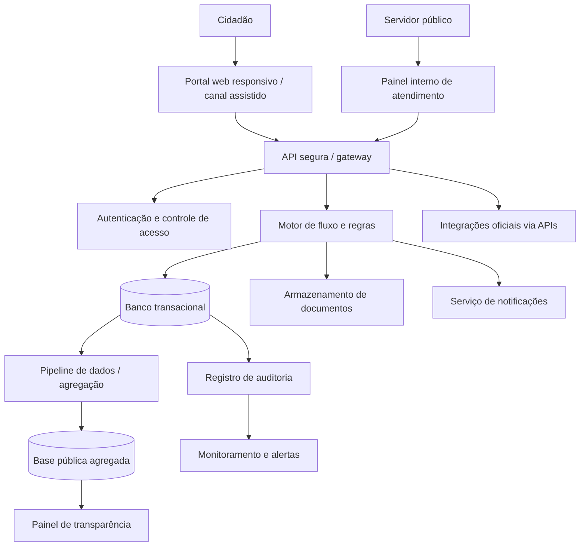

# PIST — Plataforma Integrada de Solicitações e Transparência: automação auditável de pedidos administrativos municipais com acompanhamento cidadão

## Integrantes

| Nome completo | GitHub | Área de carreira | RGM |
|---|---|---|---|
| Bruno Rodrigues | dev-rodrigues-bruno | Gestão | 48101541 |
| Caio Dal Pizzol Fonseca | Caio Fonseca | Cibersegurança e Gestão | 47923121 |
| Denner de Paula Coutinho | denner-coutinho | Engenharia de Dados e Gestão | 48094030 |
| João Vitor Pires Ribeiro | Joaovp07 | Ciência de Dados e Gestão | 47792591 |
| Nicollas Guedes Da Silva Santos | Nicollas-Guedes | Engenharia de Dados e Cloud | 48131334 |

**Dossiê:** 5 - Moderação automatizada e transparência 

**Recorte:** digitalização e automação, por regras auditáveis e com decisão final sempre humana, das solicitações administrativas de uma prefeitura, permitindo ao cidadão abrir e acompanhar o pedido online e à população consultar indicadores agregados de desempenho em um painel público. A implantação começa por um piloto em um único serviço municipal.

## 1. Análise do problema

### 1.1 Quem é afetado, onde e quanto

O problema da opacidade, lentidão e falta de transparência atinge diretamente os cidadãos que dependem da prefeitura para solicitações administrativas urbanas (ex: alvarás, zeladoria, licenciamentos). Embora 41,1% dos usuários já utilizem serviços públicos pela internet (IBGE, 2026), a maioria enfrenta processos fragmentados. A falta de transparência cria uma "caixa-preta" burocrática: o cidadão abre o pedido, mas não sabe os critérios, o status real ou o motivo exato de eventuais indeferimentos. Isso afeta desproporcionalmente populações de menor escolaridade e pequenos empreendedores locais, que perdem tempo e recursos aguardando resoluções imprevisíveis.

### 1.2 Causas

As causas que contribuem para esse cenário são majoritariamente tecnológicas e de decisões de projeto:

* **Sistemas legados e isolados:** Os dados ficam presos em secretarias diferentes, exigindo que o cidadão seja o "mensageiro" de seus próprios documentos entre os departamentos.
* **Automação opaca na gestão pública:** Quando prefeituras tentam modernizar a triagem adotando sistemas "de prateleira", frequentemente criam fluxos automatizados onde pedidos são negados ou rebaixados sem explicabilidade, gerando um ambiente de moderação administrativa excludente.
* **Falta de regras de negócio sistêmicas:** A ausência de um motor de regras (*workflow*) centralizado faz com que o andamento dependa da intervenção manual em planilhas não padronizadas e e-mails paralelos.

### 1.3 O que já existe e por que não basta

* **Balcões físicos e protocolos em papel:** Processos tradicionais de atendimento. **Por que não basta:** Exigem deslocamento, possuem alto custo de operação, são propensos a perdas de documentos e não oferecem rastreabilidade em tempo real.
* **Sistemas de Ouvidoria genéricos (ex: e-SIC / e-OUV):** Portais focados em acesso à informação pública e denúncias. **Por que não basta:** Servem como canal de registro, mas não gerenciam o fluxo de trabalho integrado das secretarias para a execução e acompanhamento de serviços fim a fim.
* **Sistemas de Inteligência Artificial para triagem pública:** Soluções que prometem prever demandas ou classificar pedidos de forma autônoma. **Por que não basta:** Introduzem vieses ocultos baseados em dados históricos (como dar prioridade a áreas centrais em detrimento de periferias) e retiram o servidor humano da validação, ferindo os princípios do devido processo e da transparência administrativa.

## 2. Proposta tecnológica

### 2.1 A solução, do ponto de vista do usuário

Propõe-se a criação da **Plataforma Integrada de Solicitações e Transparência (PIST)**, um sistema digital que reúne em um único ambiente a abertura, o encaminhamento, o acompanhamento e a prestação de contas de solicitações administrativas. O projeto busca reduzir etapas manuais, evitar perda de documentos, tornar os prazos mais previsíveis e permitir que a população acompanhe o que acontece com suas demandas.

A plataforma será destinada a cidadãos, servidores responsáveis pelo atendimento, gestores públicos e equipes de auditoria. O sistema não substitui a decisão dos servidores: automatiza tarefas repetitivas e fornece registros e informações para apoiar decisões humanas.

**Fluxo de uso:**

1. **Acesso:** o cidadão entra pelo portal responsivo, sem precisar instalar aplicativo. Para solicitações que exigem identificação, utiliza autenticação segura; quando a natureza do serviço permitir, o sistema oferece envio sem criação de conta.
2. **Escolha do serviço:** o usuário seleciona o tipo de solicitação e visualiza linguagem simples, documentos necessários, etapas previstas, prazo estimado e critérios de atendimento.
3. **Preenchimento assistido:** formulários dinâmicos mostram apenas campos necessários ao tipo de pedido. Validações automáticas indicam erros antes do envio.
4. **Protocolo:** após o envio, a plataforma gera número de protocolo e comprovante. O usuário pode consultar o status, os prazos e as movimentações sem precisar comparecer presencialmente.
5. **Triagem automatizada:** regras configuradas pela área responsável verificam completude, classificam o tipo de demanda e encaminham o pedido à unidade competente. Se houver dúvida, inconsistência ou exceção, o caso é direcionado a uma pessoa.
6. **Análise e decisão:** o servidor examina os documentos e decide sobre o pedido. A plataforma registra responsável, data, justificativa e eventuais solicitações de complementação.
7. **Notificações:** o cidadão recebe aviso sobre mudanças de status e prazos por canal escolhido, como e-mail ou SMS, sem que a notificação exponha dados pessoais.
8. **Transparência:** um painel público apresenta dados agregados — quantidade de solicitações, tempo médio, percentual dentro do prazo, pendências e volume por categoria — sem divulgar nomes, documentos ou detalhes de casos individuais.
9. **Avaliação:** após a conclusão, o cidadão pode avaliar a experiência e registrar dificuldade ou contestação.

A automação será baseada inicialmente em **regras claras e auditáveis**, e não em decisões autônomas de inteligência artificial. Isso facilita explicar por que um pedido foi classificado ou encaminhado de determinada maneira. Qualquer futura adoção de IA deverá passar por avaliação de risco, testes, supervisão humana e comunicação pública.

### 2.2 Arquitetura

A arquitetura proposta separa os canais de atendimento, as regras de negócio, o armazenamento de dados e a camada pública de transparência.

#### Dados: entrada, armazenamento e acesso

**Dados de entrada:** categoria da solicitação, descrição, dados de contato estritamente necessários, documentos comprobatórios quando exigidos, data/hora, canal de entrada e consentimentos ou avisos aplicáveis.

**Armazenamento:**
- Dados operacionais e protocolos ficam no banco transacional, em ambiente institucional ou nuvem contratada com controles de segurança.
- Documentos são armazenados separadamente, com criptografia e permissões específicas.
- Logs de auditoria são protegidos contra alteração e contêm somente os elementos necessários para rastreabilidade.
- Indicadores destinados ao painel público são processados em uma base separada, agregados e revisados para reduzir risco de reidentificação.

**Acesso:**
- Cidadãos: somente seus próprios protocolos e documentos, após autenticação quando necessária.
- Servidores: solicitações vinculadas à unidade e à função, com acesso mínimo necessário.
- Gestores: indicadores operacionais e relatórios pertinentes à sua responsabilidade.
- Auditoria, segurança e encarregado de dados: acesso controlado e registrado para apuração e conformidade.
- Público geral: somente estatísticas e informações administrativas que possam ser divulgadas legalmente.

A integração entre órgãos ocorrerá por APIs documentadas e autorizadas, evitando duplicação de dados e respeitando a finalidade de cada compartilhamento. A publicação de informações seguirá a legislação de transparência, sem expor dados pessoais protegidos.

### 2.3 O trabalho de cada área

#### Engenharia de Dados

A Engenharia de Dados será responsável por organizar o ciclo de vida dos dados da plataforma. Definirá os modelos de dados, os padrões de qualidade, os processos de integração e a separação entre registros operacionais e dados destinados à análise pública. Também implementará pipelines para calcular indicadores, validar consistência e detectar duplicidades.

Entre suas entregas estão:
- modelo de dados para protocolos, etapas, unidades e prazos;
- rotinas de extração, transformação e carga (ETL);
- catálogo e dicionário de dados;
- regras de qualidade, rastreabilidade e atualização;
- mecanismos de agregação e anonimização para os painéis públicos.

#### Ciência de Dados

A Ciência de Dados poderá analisar dados agregados para identificar gargalos, sazonalidade, categorias com maior atraso e diferenças de desempenho entre unidades. Inicialmente, os indicadores serão descritivos e explicáveis; não será utilizado um modelo preditivo para decidir direitos ou negar solicitações.

Caso futuramente seja desenvolvido um modelo para estimar demanda ou prazo, ele deverá ser validado com dados representativos, ter suas limitações documentadas, ser monitorado para detectar distorções e servir apenas como apoio ao planejamento — nunca como substituto da decisão humana.

#### Cloud Computing

A área de Cloud Computing projetará uma infraestrutura escalável e resiliente, com ambientes separados de desenvolvimento, testes e produção. Será responsável por implantação automatizada, backups, recuperação de desastre, gestão de custos, disponibilidade e atualização dos serviços.

A proposta considera:
- infraestrutura como código;
- implantação contínua com revisão e testes;
- criptografia em trânsito e em repouso;
- backups periódicos e testes de restauração;
- monitoramento de disponibilidade, desempenho e custos;
- plano de continuidade e recuperação de desastre.

A adoção de nuvem não elimina a responsabilidade do órgão sobre segurança, privacidade, contratos e continuidade do serviço.

#### Cibersegurança

A Cibersegurança definirá e acompanhará controles para proteger dados, identidades, sistemas e documentos. Entre as atividades:
- análise de ameaças e avaliação de risco antes da implantação;
- autenticação forte para servidores e administradores;
- controle de acesso baseado em função e princípio do menor privilégio;
- gestão de vulnerabilidades, atualizações e segredos;
- testes de segurança e revisão de APIs;
- monitoramento de eventos e resposta a incidentes;
- proteção contra abuso, indisponibilidade e acesso indevido;
- plano de resposta e comunicação de incidentes.

#### Redes

A área de Redes garantirá conectividade segura entre os componentes e os sistemas externos. Planejará segmentação de rede, regras de firewall, proteção de interfaces públicas, VPN ou conexão privada quando aplicável, redundância e monitoramento. Também apoiará a disponibilidade dos canais e a comunicação entre unidades administrativas.

#### Gestão

A Gestão será responsável pelo mapeamento dos processos atuais, pela definição dos serviços prioritários e pela revisão das regras administrativas antes de automatizá-las. Coordenará servidores, tecnologia, atendimento ao cidadão, jurídico, acessibilidade e proteção de dados.

Suas atribuições incluem:
- mapear processos e eliminar etapas desnecessárias;
- definir responsáveis, prazos e níveis de serviço;
- elaborar plano de implantação gradual;
- capacitar servidores e equipes de atendimento;
- acompanhar indicadores e promover melhoria contínua;
- organizar consulta pública e testes com usuários;
- garantir orçamento, governança e manutenção após o primeiro ano.

#### Como as áreas se complementam

A Gestão define o processo e os objetivos; Engenharia de Dados garante dados consistentes; Ciência de Dados transforma dados agregados em análises úteis; Cloud sustenta a plataforma; Redes assegura conectividade; e Cibersegurança protege o ambiente. As áreas trabalham em conjunto desde o levantamento de requisitos até a operação, com revisões técnicas e éticas em cada etapa. A transparência depende tanto de arquitetura e qualidade dos dados quanto de processos administrativos claros e servidores preparados.

### 2.4 O que a tecnologia não resolve

A plataforma pode reduzir trabalho repetitivo e melhorar o acompanhamento, mas não resolve sozinha problemas institucionais ou sociais. Permanecem dependentes de ação humana e de políticas públicas:

- **Decisões administrativas:** deferir, indeferir ou priorizar pedidos que envolvam análise de mérito ou direitos exige autoridade competente e justificativa.
- **Revisão de processos:** automatizar um procedimento burocrático sem redesenhá-lo pode apenas digitalizar a burocracia existente.
- **Inclusão digital:** pessoas sem internet, dispositivo, alfabetização digital ou recursos de acessibilidade precisam de atendimento presencial ou assistido.
- **Transparência efetiva:** divulgar números não substitui explicar decisões, publicar informações em linguagem clara e responder a pedidos de acesso à informação.
- **Qualidade dos dados:** a plataforma depende de registros completos e corretos; dados ruins geram indicadores enganosos.
- **Capacidade institucional:** falta de servidores, orçamento ou coordenação pode manter atrasos mesmo com automação.
- **Confiança pública:** será construída por prestação de contas, participação social, proteção de dados e correção de falhas.
- **Mudanças normativas:** regras e prazos precisam ser atualizados pelos responsáveis, não presumidos pelo sistema.

Por isso, a implantação deve ser gradual, com piloto em um serviço específico, avaliação de resultados e possibilidade de revisão ou interrupção caso os controles não sejam suficientes.

## 3. Análise ética

A plataforma PIST deve garantir segurança, privacidade e transparência no tratamento das informações dos cidadãos. A automação será utilizada para auxiliar os servidores, sem substituir a decisão humana.

### 3.1 Matriz de riscos

| # | Risco | Classificação | Impacto | Controle |
|---|---|---|---|---|
| 1 | Vazamento de dados pessoais | Segurança / Legal-privacidade | Exposição de informações dos cidadãos. | Criptografia e controle de acesso. |
| 2 | Classificação incorreta dos pedidos | Ético / Viés-inclusão | Atrasos no atendimento. | Revisão por servidores. |
| 3 | Falta de transparência | Ético / Governança | Cidadão sem informações sobre seu pedido. | Histórico e status disponíveis. |
| 4 | Acesso indevido ao sistema | Segurança | Consulta ou alteração de dados sem autorização. | Autenticação e registro de acessos. |
| 5 | Exclusão digital | Viés-inclusão / Ético | Dificuldade de acesso para parte da população. | Manter atendimento presencial e interface acessível. |
| 6 | Decisões somente automatizadas | Ético / Governança | Cidadãos prejudicados por erros do sistema. | Aprovação humana nas decisões administrativas. |

### 3.2 Decisão

**Implantar com controles**

A plataforma pode melhorar os serviços municipais, facilitar solicitações e aumentar a transparência. Porém, sua implantação depende de medidas de segurança, proteção de dados e revisão humana. O projeto deverá começar com um serviço piloto, permitindo identificar e corrigir problemas antes de sua expansão.

### 3.3 Controles antes de entrar em produção

| Eixo | Controle | Quem faz | Como saber que foi cumprido |
|---|---|---|---|
| Transparência | Informar como o sistema utiliza os dados. | Gestão | Aviso de privacidade publicado. |
| Revisão humana | Garantir decisões finais por servidores. | Prefeitura | Fluxo de aprovação testado. |
| Minimização de dados | Coletar somente dados necessários. | Desenvolvimento | Formulários revisados. |
| Segurança | Proteger acessos e informações. | Cibersegurança | Testes de segurança realizados. |
| Teste de viés | Verificar erros e possíveis discriminações. | Dados e gestão | Resultados documentados. |
| Canal de contestação | Permitir questionamentos dos cidadãos. | Prefeitura | Canal disponível e funcionando. |

### 3.4 LGPD

A plataforma deverá seguir a Lei Geral de Proteção de Dados (Lei nº 13.709/2018), coletando apenas informações necessárias e garantindo seu armazenamento seguro.

| Dado pessoal | Finalidade | Base legal | Por quanto tempo | Sensível ou de criança/adolescente? |
|---|---|---|---|---|
| Nome completo | Identificar o cidadão. | Art. 7º, III, quando aplicável. | Conforme regras de conservação documental. | Não. |
| CPF | Confirmar identidade, quando necessário. | Art. 7º, III, quando aplicável. | Conforme necessidade e obrigações legais. | Não. |
| E-mail e telefone | Enviar atualizações. | Art. 7º, III, quando aplicável. | Enquanto necessários para o atendimento. | Não. |
| Endereço | Verificar localização, quando necessário. | Art. 7º, III, quando aplicável. | Conforme necessidade do serviço. | Não. |
| Solicitação e anexos | Analisar o pedido. | Arts. 7º, 11 e 23, conforme o dado e a finalidade. | Conforme regras de conservação documental. | Podem conter. |

**Observação:** dados sensíveis ou de menores deverão receber proteção adicional. O painel público apresentará apenas indicadores agregados, sem identificar os cidadãos.

### 3.5 Comunicado público

> A PIST facilita o acesso aos serviços municipais, permitindo que os cidadãos registrem solicitações e acompanhem seu andamento pela internet. A tecnologia auxilia na organização dos pedidos, mas as decisões finais continuam sob responsabilidade dos servidores. As informações pessoais serão protegidas conforme a LGPD, e a população poderá consultar indicadores públicos de transparência.

**Contagem:** aproximadamente 430 caracteres.

**Contagem:** [N] caracteres

## 4. Acessibilidade e inclusão digital

O PIST nasce digital, mas o público de uma prefeitura é a população inteira, inclusive quem não está (ou está mal) conectado. Os números mostram que o problema não é só ter internet, e sim saber usá-la para resolver a vida:

Em 2025, 90,5% das pessoas com 10 anos ou mais usaram a internet, mas entre pessoas sem instrução só 50,1% usaram. Entre os idosos, o índice foi de 74,5%, e 66,5% dos idosos desconectados apontam como motivo não saber usar. Cerca de 4 milhões de domicílios seguem sem internet e 19,1 milhões de pessoas não têm celular próprio (IBGE, 2026).
O celular é o meio de acesso de 98,7% dos usuários, e apenas 41,1% usaram serviços públicos pela internet (IBGE, 2026). No acesso móvel, predominam planos pré-pagos, sobretudo nas classes D e E (CGI.br, 2025), ou seja, franquia de dados curta.
O Brasil tem 14,4 milhões de pessoas com deficiência (7,3% da população com 2 anos ou mais); 45,4% delas são idosas, 7,9 milhões têm dificuldade para enxergar e a taxa de analfabetismo entre pessoas com deficiência de 15 anos ou mais é de 21,3% (IBGE, 2025).
29% da população de 15 a 64 anos é analfabeta funcional, chegando a 51% na faixa de 50 a 64 anos (Inaf, 2025).

Por isso a regra de projeto é: o canal digital é uma porta a mais, nunca a única. Ninguém perde prazo, prioridade ou direito por pedir pelo balcão ou pelo telefone, o que também atende à Lei do Governo Digital (Lei 14.129/2021), que garante o atendimento presencial, e à Lei Brasileira de Inclusão (Lei 13.146/2015).

### 4.1 Quem pode ficar de fora

A plataforma deverá seguir a Lei Brasileira de Inclusão (Lei nº 13.146/2015) e a Lei do Governo Digital (Lei nº 14.129/2021), mantendo o atendimento presencial e oferecendo alternativas para quem tem dificuldade de usar o canal digital.

| Grupo | Barreira | O que a solução faz |
|---|---|---|
| Pessoas sem smartphone ou sem internet | Não conseguem abrir nem acompanhar o pedido online. | Atendimento assistido no balcão, com protocolo impresso e acompanhamento por SMS ou telefone, na mesma fila do canal digital. |
| Pessoas com plano pré-pago ou conexão fraca | Páginas pesadas consomem a franquia e não carregam. | Páginas leves, funcionamento em 3G, rascunho salvo automaticamente e avisos por SMS. |
| Pessoas idosas | Pouca familiaridade digital e dificuldade de visão ou coordenação. | Fluxo curto, letras e botões grandes, botão "Falar com uma pessoa", pedido aberto por familiar ou procurador e oficinas presenciais. |
| Pessoas cegas ou com baixa visão | Telas incompatíveis com leitor de tela, baixo contraste e informação só em cor ou gráfico. | Conformidade com a WCAG 2.2 nível AA, testes com leitores de tela e tabela equivalente para cada gráfico do painel. |
| Pessoas surdas | Atendimento só por telefone e vídeos sem tradução. | Canal escrito (chat e SMS), VLibras nas páginas e legenda nos vídeos. |
| Pessoas com deficiência motora | Dificuldade com mouse, toque preciso e limites de tempo. | Navegação completa por teclado, alvos de toque grandes e aviso antes de a sessão expirar. |
| Pessoas com baixa escolaridade | Formulários, termos técnicos e mensagens de erro difíceis de entender. | Linguagem simples, ícones com texto, uma pergunta por vez, leitura em voz alta e atendimento humano. |
| Pessoas sem conta gov.br prata ou ouro | Login complexo pode impedir o primeiro acesso. | Acesso com CPF e código por SMS; gov.br exigido só quando a lei pedir identificação forte. |

## 4.2 Requisitos de acessibilidade

A referência técnica é a WCAG 2.2, nível AA (W3C, 2024), complementada pelo eMAG (Modelo de Acessibilidade em Governo Eletrônico), que é o padrão dos órgãos públicos brasileiros. Cada requisito abaixo vira critério de aceite: a funcionalidade só vai para produção se passar.

#	Requisito concreto no PIST	Critério WCAG 2.2
* R1	Todo ícone, imagem e botão gráfico tem texto alternativo; os gráficos do painel público têm tabela de dados equivalente	1.1.1 Conteúdo não textual (A)
* R2	O formulário usa rótulos reais (<label>), títulos em ordem lógica e campos agrupados, para o leitor de tela entender a estrutura	1.3.1 Informações e relações (A); 3.3.2 Rótulos ou instruções (A)
* R3	O status do pedido nunca é indicado só por cor (ex.: "Em análise" escrito, não só um ponto amarelo)	1.4.1 Uso de cor (A)
* R4	Contraste mínimo de 4,5:1 para texto e 3:1 para bordas de campos, botões e ícones	1.4.3 Contraste mínimo (AA); 1.4.11 Contraste não textual (AA)
* R5	A página funciona com o texto ampliado em 200% e em tela de 320 px de largura sem rolagem horizontal	1.4.4 Redimensionar texto (AA); 1.4.10 Refluxo (AA)
* R6	Todas as funções (abrir, anexar, acompanhar, contestar) funcionam só pelo teclado, com foco sempre visível e nunca escondido por banners ou cabeçalhos fixos	2.1.1 Teclado (A); 2.4.7 Foco visível (AA); 2.4.11 Foco não obscurecido (AA)
* R7	Botões e links com área de toque de no mínimo 24 × 24 px (o projeto adota 44 × 44 px para facilitar o uso por idosos)	2.5.8 Tamanho do alvo – mínimo (AA)
* R8	A sessão avisa antes de expirar e permite estender o tempo; o rascunho é salvo	2.2.1 Tempo ajustável (A)
* R9	Erros são explicados em texto, com a sugestão de correção ("O CPF tem 11 números; faltam 2")	3.3.1 Identificação do erro (A); 3.3.3 Sugestão de erro (AA)
* R10	O sistema não pede de novo um dado já informado no mesmo pedido (endereço, telefone)	3.3.7 Entrada redundante (A)
* R11	O login não exige teste cognitivo (sem CAPTCHA de quebra-cabeça e sem memorizar senha); usa código por SMS ou gov.br, com colar/preencher automático liberado	3.3.8 Autenticação acessível – mínimo (AA)
* R12	O botão "Falar com uma pessoa" e o telefone de ajuda aparecem sempre no mesmo lugar em todas as telas	3.2.6 Ajuda consistente (A)
* R13	Mudanças de status e mensagens de "pedido enviado" são anunciadas pelo leitor de tela sem mudar o foco	4.1.3 Mensagens de status (AA)
* R14	Componentes personalizados (menus, abas, upload) expõem nome, função e estado corretos para tecnologias assistivas	4.1.2 Nome, função, valor (A)
* R15	Textos escritos para leitura até o nível do ensino fundamental, revisados com usuários de baixa escolaridade (meta além do AA)

## 5. Sustentabilidade

### 5.1 Impacto ambiental da solução

Como o projeto PIST baseia-se em um motor de regras determinísticas claras e rejeita propositalmente a adoção de Modelos de Linguagem (LLMs) e Inteligência Artificial preditiva, a plataforma já evita o massivo custo energético e a enorme pegada hídrica inerentes à inferência de IA. Ainda assim, a operação em nuvem (armazenamento, bancos de dados, servidores web) gera impacto ambiental devido ao consumo elétrico dos data centers e ao descarte de hardware (*e-waste*).

Escolhas tecnológicas para reduzir o impacto (TI Verde):

* **Arquitetura de Nuvem Eficiente (*Serverless*):** Utilização de serviços autoescaláveis que alocam recursos computacionais apenas no momento de uso, evitando o desperdício de manter máquinas virtuais ociosas ligadas 24 horas por dia.
* **Minimização de Armazenamento:** Políticas de compressão e retenção rígida de documentos evitam o armazenamento redundante de arquivos pesados, economizando capacidade de discos físicos (redução de hardware) e energia nos servidores.
* **Provedores de Nuvem Verdes:** Hospedagem em data centers com alta Eficácia no Uso de Energia (PUE) e compromissos firmados de abastecimento com 100% de fontes de energia renovável.

### 5.2 Sustentabilidade do projeto

* **Quem mantém:** A Secretaria de Tecnologia da Informação do município (ou órgão correlato), que ficará responsável pelo suporte de Nível 3, gerenciamento da nuvem e atualização do motor de regras.
* **Quem paga:** O orçamento da própria prefeitura municipal. O sistema se paga a médio prazo através da drástica redução de custos com papel, impressão, armazenamento físico de arquivos e pela otimização das horas de trabalho dos servidores.
* **O que acontece depois do primeiro ano:** O foco do projeto transiciona da implantação tecnológica para a governança. As equipes focarão na capacitação contínua dos servidores, no monitoramento dos painéis de transparência pública e na atualização das regras automatizadas para refletir eventuais mudanças nas leis municipais.

## 6. Impacto esperado

O piloto roda em um único serviço municipal durante 12 meses. Antes de ligar o PIST, a equipe mede por 3 meses a linha de base do processo atual (tempo de resposta, volume por canal, reclamações na ouvidoria), para que toda meta abaixo seja comparada com a situação real e não com uma estimativa.

### 6.1 Indicadores

Os indicadores serão medidos a partir dos registros do próprio PIST e comparados à linha de base do processo atual, com os resultados publicados no painel público.

| Indicador | Como medir | Meta | Prazo |
|---|---|---|---|
| Tempo médio de resposta | Intervalo entre a abertura e a resposta final, registrado no PIST. | Redução de 40%. | 6 meses. |
| Pedidos dentro do prazo | Percentual de pedidos concluídos no prazo do serviço. | No mínimo 90%. | 6 meses. |
| Adesão ao canal digital | Percentual de pedidos abertos online. | No mínimo 50%, sem reduzir o atendimento presencial. | 12 meses. |
| Conclusão do formulário | Pedidos enviados divididos pelos pedidos iniciados. | No mínimo 80%. | 3 meses. |
| Equidade entre canais | Diferença no tempo de resposta entre pedidos do balcão e online. | No máximo 10%. | 6 meses. |
| Satisfação do cidadão | Nota de 1 a 5 ao final do atendimento, em todos os canais. | Média mínima de 4, também entre pessoas 60+ e com deficiência. | 6 meses. |
| Qualidade da automação | Percentual de encaminhamentos corrigidos e de decisões revertidas. | Correções até 10% e reversões até 5%. | Mensal, a partir do 3º mês. |
| Resposta às contestações | Tempo entre a contestação e a resposta humana. | Até 10 dias úteis. | 3 meses. |
| Acessibilidade | Erros críticos nos testes da WCAG 2.2 AA. | Zero em cada versão publicada. | Contínuo. |
| Reclamações na ouvidoria | Registros da ouvidoria sobre o serviço piloto. | Redução de 30%. | 12 meses. |
| Atualização do painel público | Atraso entre o registro do dado e sua publicação. | Até 7 dias. | 3 meses. |
| Disponibilidade do sistema | Monitoramento de funcionamento (uptime). | No mínimo 99,5% ao mês. | Contínuo. |

## 6.2 Como os usuários serão ouvidos

A escuta acontece em quatro momentos, antes de qualquer decisão de ampliar o PIST para outros serviços:

Antes do piloto (descoberta): entrevistas com cerca de 20 cidadãos que já usaram o serviço escolhido (presencialmente e por telefone) e com os servidores que o operam, para mapear onde o processo trava. Os protótipos de tela são testados com o mesmo público descrito na seção 4.
Durante o piloto (contínuo): pesquisa de satisfação de uma pergunta ao final de cada atendimento, em todos os canais, com campo aberto para comentário; botão "Isto foi útil?" nas páginas; relatos de barreiras de acessibilidade pela declaração de acessibilidade; e os registros da ouvidoria.
Oficinas presenciais trimestrais em CRAS, bibliotecas e centros de convivência, para ouvir justamente quem usa pouco o canal digital, com apoio dos conselhos municipais da pessoa idosa e da pessoa com deficiência, que participam também como comitê consultivo do projeto.
Revisão de 12 meses: relatório público com os resultados, o que mudou a partir das sugestões recebidas e o que não foi possível mudar (e por quê).

Critério para ampliar: o PIST só vai para um segundo serviço se, ao final do piloto, a maior parte das metas da tabela 6.1 tiver sido atingida e nenhum grupo da seção 4.1 estiver em situação pior do que antes (satisfação menor ou tempo de resposta maior que o dos demais).

### 6.3 Se a solução não pegar

Caso a adesão ou os resultados fiquem abaixo do esperado, o atendimento presencial continuará funcionando normalmente e o PIST só será ampliado depois de corrigidos os problemas.

| Risco | Sinal de alerta | O que fazer |
|---|---|---|
| Baixa adesão ao canal digital | Menos de 20% dos pedidos online em 6 meses. | Investigar os motivos, simplificar o fluxo e divulgar em rádios comunitárias, UBS e escolas. |
| Resistência dos servidores | Pedidos tratados fora do PIST ou com registro incompleto. | Envolver os servidores no desenho, treinar no horário de trabalho e ter um servidor de referência por setor. |
| Erros da automação | Correções acima de 10% ou reversões acima de 5%. | Suspender a regra com problema, voltar à triagem manual e publicar o ocorrido no painel. |
| Exclusão de grupos vulneráveis | Satisfação ou tempo de resposta pior para pessoas 60+, com deficiência ou atendidas no balcão. | Priorizar a correção antes de novas funções e reforçar o atendimento assistido. |
| Falta de orçamento ou troca de gestão | Corte de verba ou mudança de prioridades. | Manter código aberto, documentação completa e resultados publicados para justificar a continuidade. |
| Metas não atingidas em 12 meses | Principais indicadores abaixo da meta mesmo após ajustes. | Não ampliar, manter o que funcionou e publicar as lições aprendidas. |

## 7. Quadro de decisões (mínimo 5)

| Decisão | Alternativas consideradas | Por que escolhemos esta |
|---|---|---|
| **Automação da triagem por regras claras e auditáveis, sem IA** | Sistemas de IA para classificar ou priorizar pedidos de forma autônoma; triagem 100% manual em planilhas e e-mails | Regras explícitas permitem explicar por que um pedido foi classificado ou encaminhado de determinada forma. A IA poderia trazer vieses ocultos dos dados históricos, como favorecer áreas centrais em detrimento das periferias, e também tem alto custo energético. A triagem manual mantém a lentidão e a falta de padrão que causam o problema. Qualquer uso futuro de IA dependerá de avaliação de risco, testes, supervisão humana e comunicação pública. |
| **Decisão final sempre humana** | Deferimento ou indeferimento automático pelo sistema | Deferir, indeferir ou priorizar pedidos que envolvem mérito ou direitos exige autoridade competente e justificativa. Decisões somente automatizadas aparecem na matriz de riscos (risco 6) porque podem prejudicar cidadãos por erros do sistema. A plataforma registra responsável, data e justificativa de cada decisão. |
| **Implantação por piloto em um único serviço, por 12 meses, com 3 meses de linha de base** | Implantação simultânea em todos os serviços da prefeitura | O piloto permite identificar e corrigir problemas antes da expansão. A linha de base garante que as metas sejam comparadas com a situação real, e não com estimativas. O PIST só vai para um segundo serviço se a maior parte das metas for atingida e nenhum grupo vulnerável ficar em situação pior. |
| **Canal digital como porta a mais, mantendo o atendimento presencial e por telefone** | Tornar o canal digital o único meio de solicitação | Parte da população segue fora ou mal conectada: só 50,1% das pessoas sem instrução usaram a internet, e 66,5% dos idosos desconectados dizem não saber usar (IBGE, 2026). A Lei do Governo Digital (14.129/2021) garante o atendimento presencial, e a Lei Brasileira de Inclusão (13.146/2015) exige alternativas acessíveis. Ninguém perde prazo ou prioridade por usar o balcão. |
| **Painel público apenas com indicadores agregados, em base separada da transacional** | Publicar casos individuais; não ter painel público | Base transacional e base pública ficam separadas para que o painel mostre volume, tempo médio, percentual no prazo e pendências sem expor nomes, documentos ou casos. Isso concilia a transparência (LAI) com a proteção de dados (LGPD) e reduz o risco de reidentificação. Sem painel, a população continuaria sem acompanhar o desempenho do serviço. |
| **Portal web responsivo e leve, sem aplicativo** | Aplicativo nativo para celular | O cidadão acessa sem instalar nada. O celular é o meio de acesso de 98,7% dos usuários, e predominam planos pré-pagos com franquia curta, sobretudo nas classes D e E. Por isso, páginas leves que funcionam em 3G e salvam rascunho automaticamente atendem melhor esse público. |
| **Login com CPF e código por SMS, com gov.br exigido só quando a lei pedir identificação forte** | Exigir conta gov.br prata/ouro em todos os serviços; login com senha e CAPTCHA | Um login complexo pode impedir o primeiro acesso de quem não tem conta gov.br de nível alto. Pela WCAG 2.2 (critério 3.3.8), a autenticação não deve exigir teste cognitivo, como CAPTCHA de quebra-cabeça ou memorização de senha. |
| **Acessibilidade WCAG 2.2 nível AA + eMAG como critério de aceite** | Tratar a acessibilidade como melhoria posterior à implantação | O Brasil tem 14,4 milhões de pessoas com deficiência, e 29% da população de 15 a 64 anos é analfabeta funcional. Cada requisito (R1 a R15) vira critério de aceite: a funcionalidade só vai para produção se passar. A meta é zero erros críticos em cada versão publicada. |
| **Integração entre órgãos por APIs documentadas e autorizadas** | Manter sistemas legados isolados, com o cidadão levando documentos entre secretarias; duplicar dados em cada setor | Sistemas isolados são uma das causas do problema (seção 1.2). As APIs evitam duplicação de dados e respeitam a finalidade de cada compartilhamento, como pede a LGPD. |
| **Nuvem com serviços autoescaláveis (serverless) e provedores de energia renovável** | Máquinas virtuais ligadas 24 horas por dia, mesmo ociosas | Os recursos são alocados só quando há uso, o que reduz consumo de energia e custo. Somam-se data centers com alta eficiência energética (PUE), infraestrutura como código, backups e plano de recuperação de desastre. |---|---|---|
| | | |

## 8. Capítulos individuais

### 8.1 Nicollas Guedes Da Silva Santos — Engenharia de Dados e Cloud

**Papel no projeto:** responsável por desenhar o pipeline de dados da plataforma PIST e estruturar a separação entre a base transacional (PostgreSQL) e a base pública agregada para os painéis de transparência. Produzi o modelo relacional dos protocolos, as rotinas de ETL (Extração, Transformação e Carga) para geração de indicadores sem risco de reidentificação, o dicionário de dados e as regras de qualidade e rastreabilidade que evitam duplicidades nas solicitações municipais.

**Plano de desenvolvimento**

| Competência que a solução exige | Técnica ou comportamental | Já tenho? |
|---|---|---|
| Modelagem de dados relacionais e transacionais para ambientes de alta disponibilidade | Técnica | Parcial (domino conceitos básicos, preciso aprofundar em otimização de índices para grandes volumes) |
| Construção de pipelines de ETL seguros com anonimização de dados sensíveis | Técnica | Não (preciso estudar LGPD aplicada a engenharia de dados e mascaramento) |
| Comunicação técnica e alinhamento com áreas de Cibersegurança e Gestão | Comportamental | Sim (atuei ativamente nas reuniões de alinhamento da arquitetura) |

**Metas SMART (6 a 12 meses)**
1. Concluir a certificação oficial em engenharia de dados em nuvem (focada em PostgreSQL e pipelines de ETL) e implementar um pipeline automatizado de anonimização em ambiente de homologação até maio de 2027.

**Feedback dos colegas**
 demonstrou excelente domínio técnico ao estruturar o banco de dados da PIST, garantindo que o fluxo de informações entre os protocolos e o painel de transparência funcionasse sem gargalos. Sua participação foi fundamental para separar os dados operacionais dos indicadores públicos de forma segura. Como ponto de desenvolvimento para os próximos projetos, sugerimos que ele lidere também a documentação das APIs de integração com sistemas externos.

### 8.2 Bruno Rodrigues — Gestão

**Papel no projeto:** fui responsável pela seção 7 (Quadro de decisões), em que consolidei as principais escolhas do projeto PIST, as alternativas consideradas e a justificativa de cada uma, sempre com base nas análises das demais seções. Também fiz o levantamento e a conferência das fontes que sustentam essas decisões (IBGE, Inaf, CGI.br, LGPD, LAI, Lei do Governo Digital, Lei Brasileira de Inclusão, WCAG 2.2 e eMAG) e organizei as referências para que cada dado citado no trabalho tivesse origem verificável.

**Plano de desenvolvimento**

| Competência que a solução exige | Técnica ou comportamental | Já tenho? |
|---|---|---|
| Tomada de decisão estruturada, comparando alternativas e justificando escolhas | Comportamental | Parcial (ainda não tenho experiência profissional na área, mas apliquei em projetos acadêmicos e neste trabalho, no quadro de decisões) |
| Pesquisa e verificação de fontes e dados para embasar decisões de gestão | Técnica | Parcial (pratiquei em projetos e no levantamento de referências do PIST; preciso me aprofundar em análise de indicadores públicos) |
| Mapeamento de processos e gestão de projetos públicos (prazos, responsáveis, implantação gradual) | Técnica | Não (não tenho experiência profissional; conheço os conceitos pelos estudos e projetos) |
| Comunicação e alinhamento com áreas técnicas (Dados, Cloud, Cibersegurança) | Comportamental | Sim (atuei integrando as decisões das diferentes áreas no quadro de decisões) |

**Metas SMART (6 a 12 meses)**

Concluir um curso de gestão de projetos com foco em metodologias ágeis e mapeamento de processos (BPMN) e aplicar o que aprendi mapeando o fluxo completo de um processo real (acadêmico ou de estágio), documentando etapas, responsáveis e prazos, até novembro de 2027.

**Feedback dos colegas**

Recebi um feedback positivo dos colegas, que destacaram a organização do quadro de decisões, por conectar as escolhas do projeto às análises das demais seções, e o meu cuidado em buscar e conferir as fontes utilizadas. Como ponto de desenvolvimento, me sugeriram buscar experiência prática em gestão de projetos, como estágio ou projetos de extensão, para complementar minha base acadêmica.

### 8.3 Denner de Paula Coutinho — Engenharia de Dados e Gestão

**Papel no projeto:** fiquei com as seções 4 (Acessibilidade e inclusão digital) e 6 (Impacto esperado). Na 4, juntei os dados do IBGE, do CGI.br e do Inaf sobre quem está desconectado ou tem alguma deficiência e montei a tabela com cada grupo que pode ficar de fora do PIST e o que a plataforma faz por ele. Também traduzi a WCAG 2.2 nível AA e o eMAG em 15 requisitos (R1 a R15), que funcionam como critério de aceite: se a tela não passa, não vai para produção. Na 6, defini os 12 indicadores do piloto com meta e prazo, a linha de base de 3 meses medida antes de ligar o sistema, as etapas de escuta dos usuários, a regra para levar o PIST a um segundo serviço e a tabela do que fazer se a solução não pegar. Escrevi tudo em cima da proposta tecnológica da seção 2, para que cada indicador saia dos registros que a própria plataforma já guarda.

**Plano de desenvolvimento**

| Competência que a solução exige | Técnica ou comportamental | Já tenho? |
|---|---|---|
| Definir indicadores com linha de base, meta e prazo, calculados a partir dos registros do sistema | Técnica | Não (defini os indicadores do PIST no papel, mas nunca montei um pipeline que os calcule sozinho) |
| Modelar dados para indicadores públicos, com consistência e agregação que não permita identificar ninguém | Técnica | Parcial (conheço modelagem e ETL na teoria; falta prática com dados reais e com anonimização) |
| Aplicar e testar a WCAG 2.2 e o eMAG | Técnica | Parcial (estudei os critérios para escrever os requisitos, mas ainda não testei uma página com leitor de tela) |
| Conduzir pesquisa com usuários, principalmente com idosos, pessoas com deficiência e quem usa pouco a internet | Comportamental | Não (planejei a escuta no trabalho, mas nunca fiz uma entrevista ou teste com usuário) |
| Acompanhar riscos de um projeto, com sinais de alerta e plano B | Técnica | Parcial (montei a tabela da seção 6.3; falta aplicar num projeto com prazo e responsável de verdade) |
| Trabalhar junto com quem cuida da parte técnica e da gestão | Comportamental | Sim (ajustei indicadores e requisitos com a proposta tecnológica e com as seções dos colegas) |

**Metas SMART (6 a 12 meses)**

1. Até junho de 2027, terminar um curso de engenharia de dados com SQL e ETL e publicar no GitHub um projeto que calcule pelo menos 5 indicadores a partir de uma base pública, como a PNAD Contínua, e os mostre num painel que se atualiza sozinho.
2. Até março de 2027, auditar a acessibilidade de 3 sites de serviços públicos usando ferramentas automáticas e o leitor de tela NVDA, e publicar no GitHub um relatório com pelo menos 10 problemas, cada um ligado ao critério da WCAG 2.2 e com a correção sugerida.
3. Até novembro de 2027, entrar num projeto prático (estágio, extensão ou voluntariado) em que eu faça pelo menos 5 entrevistas ou testes com usuários e acompanhe indicadores que eu mesmo defini, registrando o que mudou por causa dos resultados.

**Feedback dos colegas**

O Denner fez a ponte entre a proposta técnica e as pessoas que vão usar o PIST. A seção de acessibilidade começa pelos números de quem fica de fora e termina em requisitos que dá para testar, e a de impacto tem metas comparadas com uma linha de base real e uma regra objetiva para decidir se o projeto cresce ou não. Gostamos especialmente de ele ter incluído a comparação entre o atendimento no balcão e o online, para garantir que ninguém seja prejudicado por não usar a internet. Como próximo passo, sugerimos que ele leve isso para a área técnica dele, mostrando como os dados de cada indicador seriam coletados e processados no pipeline, e que procure experiência real de pesquisa com usuários para testar na prática o que planejou aqui.

### 8.4 [Próximo integrante (se houver)] — [Área]
### 8.5 [Próximo integrante (se houver)] — [Área]

## 9. Referências

* CGI.br / NIC.br. *Sistematização da Consulta Pública sobre Regulação de Plataformas Digitais*. Comitê Gestor da Internet no Brasil, dezembro de 2024. [https://www.cgi.br/](https://www.cgi.br/)

* DATA PRIVACY BRASIL. *Asymmetries of Information and Algorithmic Governance in Content Moderation*. Associação de Pesquisa Data Privacy Brasil, novembro de 2024. [https://www.dataprivacybr.org/](https://www.dataprivacybr.org/)

* INTERNETLAB. *Pesquisa em Moderação de Conteúdo, Direitos Digitais e Liberdade de Expressão*. InternetLab, março de 2025. [https://internetlab.org.br/](https://internetlab.org.br/)

* ITS RIO. *Governança de Plataformas Digitais e Transparência Algorítmica*. Instituto de Tecnologia e Sociedade do Rio de Janeiro, 2025. [https://itsrio.org/](https://itsrio.org/)

* SCHWARTZ, Roy et al. *Green AI e Eficiência Energética em LLMs - Revisão Atualizada*. Communications of the ACM, 2025. [https://dl.acm.org/](https://dl.acm.org/)

* UNIÃO EUROPEIA. *Digital Services Act (DSA) - Relatórios de Transparência e Implementação*. Jornal Oficial da União Europeia, 2024. [https://eur-lex.europa.eu/](https://eur-lex.europa.eu/)

* BRASIL. **Lei nº 13.709, de 14 de agosto de 2018 — Lei Geral de Proteção de Dados Pessoais (LGPD)**. Presidência da República, 2018. [https://www.planalto.gov.br/ccivil_03/_ato2015-2018/2018/lei/l13709.htm](https://www.planalto.gov.br/ccivil_03/_ato2015-2018/2018/lei/l13709.htm)

* ANPD. **Guia Orientativo: Tratamento de Dados Pessoais pelo Poder Público**. Autoridade Nacional de Proteção de Dados. [https://www.gov.br/anpd/pt-br/centrais-de-conteudo/materiais-educativos-e-publicacoes/guia_orientativo_tratamento_de_dados_pessoais_pelo_poder_publico](https://www.gov.br/anpd/pt-br/centrais-de-conteudo/materiais-educativos-e-publicacoes/guia_orientativo_tratamento_de_dados_pessoais_pelo_poder_publico)

* BRASIL. **Lei nº 12.527, de 18 de novembro de 2011 — Lei de Acesso à Informação (LAI)**. Presidência da República, 2011. [https://www.planalto.gov.br/ccivil_03/_ato2011-2014/2011/lei/l12527.htm](https://www.planalto.gov.br/ccivil_03/_ato2011-2014/2011/lei/l12527.htm)

*  BRASIL. Ministério da Gestão e da Inovação em Serviços Públicos. **Automação de Serviços**. Governo Digital. Disponível em: [https://www.gov.br/governodigital/pt-br/estrategias-e-governanca-digital/transformacao-digital/ferramentas/automacao-de-servicos/automacao-de-servicos.]

* BRASIL. Ministério da Gestão e da Inovação em Serviços Públicos. **Plano de Transformação Digital (PTD)**. Governo Digital, 16 maio 2024. Disponível em: [https://www.gov.br/governodigital/pt-br/estrategias-e-governanca-digital/sisp/guia-do-gestor/guia-orientativo-de-padroes-e-fluxos-das-tecnologias-de-transformacao-digital/plano-de-transformacao-digital-ptd.]

* BRASIL. Ministério da Gestão e da Inovação em Serviços Públicos. **Lei do Governo Digital**. Disponível em: [https://www.gov.br/governodigital/pt-br/legislacao/lei-do-governo-digital.]

* BRASIL. Autoridade Nacional de Proteção de Dados. **Guia orientativo: Tratamento de dados pessoais pelo Poder Público**. Publicado em 22 nov. 2024; modificado em 23 jan. 2025. Disponível em: [https://www.gov.br/anpd/pt-br/centrais-de-conteudo/materiais-educativos-e-publicacoes/guia_orientativo_tratamento_de_dados_pessoais_pelo_poder_publico.]

* W3C. **Web Content Accessibility Guidelines (WCAG) 2.2**. Recomendação de 12 dez. 2024. Disponível em: [https://www.w3.org/TR/wcag/.]

* IBGE. PNAD Contínua: Acesso à Internet e à televisão e posse de telefone móvel celular para uso pessoal 2025. Agência de Notícias IBGE, 2 jul. 2026. Disponível em: https://agenciadenoticias.ibge.gov.br/agencia-noticias/2012-agencia-de-noticias/noticias/47408-proporcao-de-usuarios-da-internet-no-pais-ultrapassou-90-da-populacao-de-10-anos-ou-mais-em-2025

* IBGE. Censo Demográfico 2022: Pessoas com Deficiência e Pessoas Diagnosticadas com Transtorno do Espectro Autista – Resultados preliminares da amostra. Agência de Notícias IBGE, 23 maio 2025. Disponível em: https://agenciadenoticias.ibge.gov.br/agencia-noticias/2012-agencia-de-noticias/noticias/43463-censo-2022-brasil-tem-14-4-milhoes-de-pessoas-com-deficiencia

* AÇÃO EDUCATIVA; INSTITUTO PAULO MONTENEGRO. Indicador de Alfabetismo Funcional (Inaf) 2024/2025. Maio de 2025. Disponível em: https://alfabetismofuncional.org.br/

* CGI.br / CETIC.br. Pesquisa TIC Domicílios. Comitê Gestor da Internet no Brasil, 2025. Disponível em: https://cetic.br/pt/pesquisa/domicilios/

* BRASIL. Lei nº 13.146, de 6 de julho de 2015 — Lei Brasileira de Inclusão da Pessoa com Deficiência. Disponível em: https://www.planalto.gov.br/ccivil_03/_ato2015-2018/2015/lei/l13146.htm

* BRASIL. Lei nº 14.129, de 29 de março de 2021 — Lei do Governo Digital. Disponível em: https://www.planalto.gov.br/ccivil_03/_ato2019-2022/2021/lei/l14129.htm

* BRASIL. Ministério do Planejamento, Orçamento e Gestão. eMAG — Modelo de Acessibilidade em Governo Eletrônico, versão 3.1. 2014. Disponível em: https://emag.governoeletronico.gov.br
