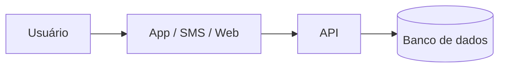

# PIST — Plataforma Integrada de Solicitações e Transparência: automação auditável de pedidos administrativos municipais com acompanhamento cidadão


## Integrantes

* Bruno Rodrigues | dev-rodrigues-bruno | Gestão | 48101541  
* Caio Dal Pizzol Fonseca | caio-fonseca | Cibersegurança e Gestão | 47923121
* Denner de Paula Coutinho | denner-coutinho | Engenharia de Dados e Gestão | 48094030
* João Vitor Pires Ribeiro | Joaovp07 | Ciência de Dados e Gestão | 47792591
* Nicollas Guedes Da Silva Santos | Nicollas-Guedes | Engenharia de Dados e Cloud | 48131334

**Dossiê:** 5 - Moderação automatizada e transparência 

**Recorte:** digitalização e automação, por regras auditáveis e com decisão final sempre humana, das solicitações administrativas de uma prefeitura, permitindo ao cidadão abrir e acompanhar o pedido online e à população consultar indicadores agregados de desempenho em um painel público. A implantação começa por um piloto em um único serviço municipal.


| Nome completo (ordem alfabética) | GitHub | Área de carreira | RGM |
|---|---|---|---|
| [Nome] | [@usuario] | [Área] | [RGM] |


**Dossiê:** [número e título]
**Recorte:** [público, região ou etapa, com a justificativa; ou "sem recorte"]


## 1. Análise do problema


### 1.1 Quem é afetado, onde e quanto
[Dados, com a fonte citada]


### 1.2 Causas
[Destaque para as causas tecnológicas: sistemas, dados, redes, decisões de projeto]


### 1.3 O que já existe e por que não basta


## 2. Proposta tecnológica


### 2.1 A solução, do ponto de vista do usuário
[O que é, para quem, e como funciona passo a passo]


### 2.2 Arquitetura





[Que dados entram, onde ficam e quem acessa]


### 2.3 O trabalho de cada área


#### [Área 1]
#### [Área 2]
#### Como as áreas se complementam


### 2.4 O que a tecnologia não resolve


## 3. Análise ética


### 3.1 Matriz de riscos (mínimo 5)


| # | Risco | Classificação | Impacto (quem e quão grave) | Controle |
|---|---|---|---|---|
| 1 | | [ético / legal-privacidade / segurança / viés-inclusão / governança] | | |


### 3.2 Decisão
**[Implantar | Implantar com controles | Não implantar ainda]**
[Justificativa em até 10 linhas]


### 3.3 Controles antes de entrar em produção


| Eixo | Controle | Quem faz | Como saber que foi cumprido |
|---|---|---|---|
| Transparência | | | |
| Revisão humana | | | |
| Minimização de dados | | | |
| Segurança | | | |
| Teste de viés | | | |
| Canal de contestação | | | |


### 3.4 LGPD


| Dado pessoal | Finalidade | Base legal | Por quanto tempo | Sensível ou de criança/adolescente? |
|---|---|---|---|---|
| | | | | |


### 3.5 Comunicado público


> [Texto de até 600 caracteres para o LinkedIn da consultoria]


**Contagem:** [N] caracteres


## 4. Acessibilidade e inclusão digital


### 4.1 Quem pode ficar de fora


| Grupo | Barreira | O que a solução faz |
|---|---|---|
| | | |


### 4.2 Requisitos de acessibilidade
[Requisitos concretos, com o critério WCAG correspondente]


## 5. Sustentabilidade


### 5.1 Impacto ambiental da solução
### 5.2 Sustentabilidade do projeto
[Quem mantém, quem paga, o que acontece depois do primeiro ano]


## 6. Impacto esperado


### 6.1 Indicadores


| Indicador | Como medir | Meta | Prazo |
|---|---|---|---|
| | | | |


### 6.2 Como os usuários serão ouvidos
### 6.3 Se a solução não pegar


## 7. Quadro de decisões (mínimo 5)


| Decisão | Alternativas consideradas | Por que escolhemos esta |
|---|---|---|
| | | |


## 8. Capítulos individuais


### 8.1 [Nome do integrante] — [Área]


**Papel no projeto:** [pelo que respondeu e o que produziu]


**Plano de desenvolvimento**


| Competência que a solução exige | Técnica ou comportamental | Já tenho? |
|---|---|---|
| | | |


**Metas SMART (6 a 12 meses)**
1. [Específica, mensurável, atingível, relevante e com prazo]


**Feedback dos colegas**
[Avaliação construtiva e propositiva, escrita em conjunto pelos demais integrantes]


### 8.2 [Próximo integrante] — [Área]
### 8.3 [Próximo integrante] — [Área]
### 8.4 [Próximo integrante (se houver)] — [Área]
### 8.5 [Próximo integrante (se houver)] — [Área]


## 9. Referências


- [Autor ou órgão]. *[Título]*. [Veículo], [data]. [link]
````
