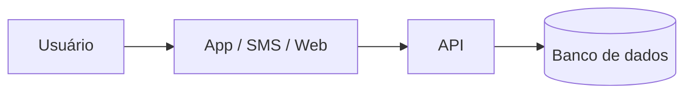

# PIST — Plataforma Integrada de Solicitações e Transparência: automação auditável de pedidos administrativos municipais com acompanhamento cidadão


## Integrantes

* Bruno Rodrigues | dev-rodrigues-bruno | Gestão | 48101541  
* Caio Dal Pizzol Fonseca | caio-fonseca | Cibersegurança e Gestão | 47923121
* Denner de Paula Coutinho | denner-coutinho | Engenharia de Dados e Gestão | 48094030
* João Vitor Pires Ribeiro | Joaovp07 | Ciência de Dados e Gestão | 47792591
* Nicollas Guedes Da Silva Santos | Nicollas-Guedes | Engenharia de Dados e Cloud | 48131334

**Dossiê:** 5 - Moderação automatizada e transparência 

**Recorte:** digitalização e automação, por regras auditáveis e com decisão final sempre humana, das solicitações administrativas de uma prefeitura, permitindo ao cidadão abrir e acompanhar o pedido online e à população consultar indicadores agregados de desempenho em um painel público. A implantação começa por um piloto em um único serviço municipal.


## 1. Análise do problema

### 1.1 Quem é afetado, onde e quanto

A moderação automatizada de conteúdo impacta diretamente bilhões de usuários de plataformas digitais globalmente e no Brasil, com efeitos desproporcionais sobre criadores de conteúdo, ativistas, minorias representativas e pequenos empreendedores.

* **Volume de Conteúdo Afetado:** Estima-se que as principais plataformas de redes sociais removam proativamente mais de 100 milhões de conteúdos por trimestre por meio de filtros automatizados. Contudo, relatórios de transparência decorrentes do *Digital Services Act (DSA)* revelam que centenas de milhares de decisões tomadas por IA envolvem falsos positivos diários.
* **Impacto no Brasil:** Pesquisas do *InternetLab* e do *CGI.br / NIC.br* apontam que usuários no Brasil enfrentam retenção indevida de contas e restrição silenciosa de alcance (*shadowbanning*) sem notificação detalhada. A super-moderação atinge desproporcionalmente o contra-discurso, a sátira e dialetos regionais.
* **Danos Econômicos e Liberdade de Expressão:** Empreendedores dependentes de comércio social perdem receitas imediatas ao sofrerem bloqueios de conta não fundamentados, enquanto o devido processo digital é cerceado pela ausência de canais de apelação eficientes.

### 1.2 Causas

As falhas de moderação automatizada decorrem de fatores estruturais e, prioritariamente, de escolhas e limitações arquiteturais de tecnologia:

1. **Efeito Caixa-Preta (*Black-Box*) dos Modelos:** O uso de redes profundas (NLP/LLMs) impede a rastreabilidade da decisão. O sistema classifica uma publicação como "violação de diretrizes", mas não fornece o motivo lógico ou o trecho exato.
2. **Vieses de Treinamento e Incompetência Contextual:** Algoritmos são treinados com conjuntos de dados (*datasets*) predominantemente anglófonos ou centralizados, incapazes de discernir ironia, linguagem figurada, gírias locais e ressignificação de termos.
3. **Limitações de Correspondência de Hash:** Filtros de assinaturas digitais (*hashes* exatas ou perceptuais) falham diante de conteúdos inéditos ou ligeiramente modificados e não avaliam o contexto em que a mídia foi compartilhada (ex: denúncia de um crime vs. apologia ao crime).
4. **Pipeline de Apelação Automatizado:** Para reduzir custos de operação, as plataformas utilizam os mesmos algoritmos classificadores para julgar os recursos dos usuários, eliminando a revisão humana qualificada.

### 1.3 O que já existe e por que não basta

* **Filtros de Heurística e Classificadores Nativos:** Plataformas utilizam algoritmos próprios baseados em inteligência artificial generativa e aprendizado de máquina para triagem em tempo real. **Por que não basta:** Operam sob segredo industrial, sem transparência algorítmica, auditoria externa ou explicabilidade ao usuário afetado.
* **Portais Legados de Denúncia:** Sistemas de notificação e retirada (*notice and take-down*) dependentes de denúncias de usuários. **Por que não basta:** Sofrem com coordenação de ataques (*brigading*), falta de feedback transparente sobre a decisão final e demora no processamento manual de apelações.
* **Estruturas de Autorregulação das Plataformas:** Conselhos de segurança e relatórios voluntários de transparência. **Por que não basta:** Apresentam métricas agregadas que escondem taxas reais de erro e falsos positivos, além de carecerem de conformidade com normativas de devido processo digital como o DSA europeu e as exigências em debate no PL 2630/2020 e Art. 19 do Marco Civil da Internet no Brasil.


## 2. Proposta tecnológica


### 2.1 A solução, do ponto de vista do usuário
[O que é, para quem, e como funciona passo a passo]


### 2.2 Arquitetura





[Que dados entram, onde ficam e quem acessa]


### 2.3 O trabalho de cada área


#### [Área 1]
#### [Área 2]
#### Como as áreas se complementam


### 2.4 O que a tecnologia não resolve


## 3. Análise ética


### 3.1 Matriz de riscos (mínimo 5)


| # | Risco | Classificação | Impacto (quem e quão grave) | Controle |
|---|---|---|---|---|
| 1 | | [ético / legal-privacidade / segurança / viés-inclusão / governança] | | |


### 3.2 Decisão
**[Implantar | Implantar com controles | Não implantar ainda]**
[Justificativa em até 10 linhas]


### 3.3 Controles antes de entrar em produção


| Eixo | Controle | Quem faz | Como saber que foi cumprido |
|---|---|---|---|
| Transparência | | | |
| Revisão humana | | | |
| Minimização de dados | | | |
| Segurança | | | |
| Teste de viés | | | |
| Canal de contestação | | | |


### 3.4 LGPD


| Dado pessoal | Finalidade | Base legal | Por quanto tempo | Sensível ou de criança/adolescente? |
|---|---|---|---|---|
| | | | | |


### 3.5 Comunicado público


> [Texto de até 600 caracteres para o LinkedIn da consultoria]


**Contagem:** [N] caracteres


### 4. Acessibilidade e inclusão digital

O PIST nasce digital, mas o público de uma prefeitura é a população inteira, inclusive quem não está (ou está mal) conectado. Os números mostram que o problema não é só ter internet, e sim saber usá-la para resolver a vida:

Em 2025, 90,5% das pessoas com 10 anos ou mais usaram a internet, mas entre pessoas sem instrução só 50,1% usaram. Entre os idosos, o índice foi de 74,5%, e 66,5% dos idosos desconectados apontam como motivo não saber usar. Cerca de 4 milhões de domicílios seguem sem internet e 19,1 milhões de pessoas não têm celular próprio (IBGE, 2026).
O celular é o meio de acesso de 98,7% dos usuários, e apenas 41,1% usaram serviços públicos pela internet (IBGE, 2026). No acesso móvel, predominam planos pré-pagos, sobretudo nas classes D e E (CGI.br, 2025), ou seja, franquia de dados curta.
O Brasil tem 14,4 milhões de pessoas com deficiência (7,3% da população com 2 anos ou mais); 45,4% delas são idosas, 7,9 milhões têm dificuldade para enxergar e a taxa de analfabetismo entre pessoas com deficiência de 15 anos ou mais é de 21,3% (IBGE, 2025).
29% da população de 15 a 64 anos é analfabeta funcional, chegando a 51% na faixa de 50 a 64 anos (Inaf, 2025).

Por isso a regra de projeto é: o canal digital é uma porta a mais, nunca a única. Ninguém perde prazo, prioridade ou direito por pedir pelo balcão ou pelo telefone, o que também atende à Lei do Governo Digital (Lei 14.129/2021), que garante o atendimento presencial, e à Lei Brasileira de Inclusão (Lei 13.146/2015).

### 4.1 Quem pode ficar de fora

A plataforma deverá seguir a Lei Brasileira de Inclusão (Lei nº 13.146/2015) e a Lei do Governo Digital (Lei nº 14.129/2021), mantendo o atendimento presencial e oferecendo alternativas para quem tem dificuldade de usar o canal digital.

| Grupo | Barreira | O que a solução faz |
|---|---|---|
| Pessoas sem smartphone ou sem internet | Não conseguem abrir nem acompanhar o pedido online. | Atendimento assistido no balcão, com protocolo impresso e acompanhamento por SMS ou telefone, na mesma fila do canal digital. |
| Pessoas com plano pré-pago ou conexão fraca | Páginas pesadas consomem a franquia e não carregam. | Páginas leves, funcionamento em 3G, rascunho salvo automaticamente e avisos por SMS. |
| Pessoas idosas | Pouca familiaridade digital e dificuldade de visão ou coordenação. | Fluxo curto, letras e botões grandes, botão "Falar com uma pessoa", pedido aberto por familiar ou procurador e oficinas presenciais. |
| Pessoas cegas ou com baixa visão | Telas incompatíveis com leitor de tela, baixo contraste e informação só em cor ou gráfico. | Conformidade com a WCAG 2.2 nível AA, testes com leitores de tela e tabela equivalente para cada gráfico do painel. |
| Pessoas surdas | Atendimento só por telefone e vídeos sem tradução. | Canal escrito (chat e SMS), VLibras nas páginas e legenda nos vídeos. |
| Pessoas com deficiência motora | Dificuldade com mouse, toque preciso e limites de tempo. | Navegação completa por teclado, alvos de toque grandes e aviso antes de a sessão expirar. |
| Pessoas com baixa escolaridade | Formulários, termos técnicos e mensagens de erro difíceis de entender. | Linguagem simples, ícones com texto, uma pergunta por vez, leitura em voz alta e atendimento humano. |
| Pessoas sem conta gov.br prata ou ouro | Login complexo pode impedir o primeiro acesso. | Acesso com CPF e código por SMS; gov.br exigido só quando a lei pedir identificação forte. |

### 4.2 Requisitos de acessibilidade

A referência técnica é a WCAG 2.2, nível AA (W3C, 2024), complementada pelo eMAG (Modelo de Acessibilidade em Governo Eletrônico), que é o padrão dos órgãos públicos brasileiros. Cada requisito abaixo vira critério de aceite: a funcionalidade só vai para produção se passar.

#	Requisito concreto no PIST	Critério WCAG 2.2
- R1	Todo ícone, imagem e botão gráfico tem texto alternativo; os gráficos do painel público têm tabela de dados equivalente	1.1.1 Conteúdo não textual (A)
- R2	O formulário usa rótulos reais (<label>), títulos em ordem lógica e campos agrupados, para o leitor de tela entender a estrutura	1.3.1 Informações e relações (A); 3.3.2 Rótulos ou instruções (A)
- R3	O status do pedido nunca é indicado só por cor (ex.: "Em análise" escrito, não só um ponto amarelo)	1.4.1 Uso de cor (A)
- R4	Contraste mínimo de 4,5:1 para texto e 3:1 para bordas de campos, botões e ícones	1.4.3 Contraste mínimo (AA); 1.4.11 Contraste não textual (AA)
- R5	A página funciona com o texto ampliado em 200% e em tela de 320 px de largura sem rolagem horizontal	1.4.4 Redimensionar texto (AA); 1.4.10 Refluxo (AA)
- R6	Todas as funções (abrir, anexar, acompanhar, contestar) funcionam só pelo teclado, com foco sempre visível e nunca escondido por banners ou cabeçalhos fixos	2.1.1 Teclado (A); 2.4.7 Foco visível (AA); 2.4.11 Foco não obscurecido (AA)
- R7	Botões e links com área de toque de no mínimo 24 × 24 px (o projeto adota 44 × 44 px para facilitar o uso por idosos)	2.5.8 Tamanho do alvo – mínimo (AA)
- R8	A sessão avisa antes de expirar e permite estender o tempo; o rascunho é salvo	2.2.1 Tempo ajustável (A)
- R9	Erros são explicados em texto, com a sugestão de correção ("O CPF tem 11 números; faltam 2")	3.3.1 Identificação do erro (A); 3.3.3 Sugestão de erro (AA)
- R10	O sistema não pede de novo um dado já informado no mesmo pedido (endereço, telefone)	3.3.7 Entrada redundante (A)
- R11	O login não exige teste cognitivo (sem CAPTCHA de quebra-cabeça e sem memorizar senha); usa código por SMS ou gov.br, com colar/preencher automático liberado	3.3.8 Autenticação acessível – mínimo (AA)
- R12	O botão "Falar com uma pessoa" e o telefone de ajuda aparecem sempre no mesmo lugar em todas as telas	3.2.6 Ajuda consistente (A)
- R13	Mudanças de status e mensagens de "pedido enviado" são anunciadas pelo leitor de tela sem mudar o foco	4.1.3 Mensagens de status (AA)
- R14	Componentes personalizados (menus, abas, upload) expõem nome, função e estado corretos para tecnologias assistivas	4.1.2 Nome, função, valor (A)
- R15	Textos escritos para leitura até o nível do ensino fundamental, revisados com usuários de baixa escolaridade (meta além do AA)


## 5. Sustentabilidade

### 5.1 Impacto ambiental da solução

O processamento de Inteligência Artificial para moderação em larga escala impõe uma expressiva pegada ecológica que demanda estratégias de *Green AI*:

* **Consumo Energético de Data Centers:** A inferência contínua em tempo real usando modelos de grande porte (LLMs) gera consumo elétrico intensivo e altas emissões de CO₂ em infraestruturas de nuvem.
* **Pegada Hídrica e Descarte de Hardware (E-Waste):** O resfriamento de servidores de GPU/TPU consome recursos hídricos significativos, enquanto a rápida substituição de hardware de aceleração acelera o acúmulo de lixo eletrônico.
* **Escolhas Tecnológicas de TI Verde para Mitigação:**
* **Arquitetura de Filtragem em Camadas:** Uso de algoritmos de baixo custo energético (*hashing* e regras heurísticas) na primeira etapa de triagem, acionando modelos complexos de NLP/LLM apenas para conteúdos limítrofes.
* **Destilação de Modelos (*Model Distillation*):** Emprego de modelos compactos (*Small Language Models* - SLMs) otimizados para inferência local com redução de até 90% no consumo energético por requisição.
* **Provedores com Energia Renovável:** Hospedagem em data centers com certificação PUE (*Power Usage Effectiveness*) otimizada e alimentados por fontes 100% renováveis.


### 5.2 Sustentabilidade do projeto

A perenidade da solução envolve sustentabilidade operacional, financeira e humana:

* **Quem Mantém:** Equipe técnica multidisciplinar composta por Engenheiros de Dados (manutenção do pipeline e *datasets*), Especialistas em Cibersegurança/Privacidade (conformidade LGPD e auditoria de APIs) e Moderadores Humanos de apoio para casos de apelação.
* **Sustentabilidade Humana e Social:** Estabelecimento de jornadas de trabalho controladas, rotação de tarefas e suporte de saúde mental contínuo para revisores humanos terceirizados, evitando a superexposição a conteúdos nocivos e garantindo o trabalho digno na cadeia de suprimentos de IA.
* **Modelo Financeiro:** Custeio viabilizado por taxa de governança de conformidade cobrada de plataformas integradas, fundos institucionais de fomento à transparência algorítmica ou parcerias público-privadas de interesse social.
* **Após o Primeiro Ano:** Transição para um modelo de governança aberta e multissetorial (*open-source* com API de auditoria para pesquisadores acadêmicos do Data Privacy Brasil, InternetLab e ITS Rio), garantindo atualizações contínuas de segurança e reavaliação periódica dos modelos de viés.


## 6. Impacto esperado


### 6.1 Indicadores


| Indicador | Como medir | Meta | Prazo |
|---|---|---|---|
| | | | |


### 6.2 Como os usuários serão ouvidos
### 6.3 Se a solução não pegar


## 7. Quadro de decisões (mínimo 5)


| Decisão | Alternativas consideradas | Por que escolhemos esta |
|---|---|---|
| | | |


## 8. Capítulos individuais


### 8.1 [Nome do integrante] — [Área]


**Papel no projeto:** [pelo que respondeu e o que produziu]


**Plano de desenvolvimento**


| Competência que a solução exige | Técnica ou comportamental | Já tenho? |
|---|---|---|
| | | |


**Metas SMART (6 a 12 meses)**
1. [Específica, mensurável, atingível, relevante e com prazo]


**Feedback dos colegas**
[Avaliação construtiva e propositiva, escrita em conjunto pelos demais integrantes]


### 8.2 [Próximo integrante] — [Área]
### 8.3 [Próximo integrante] — [Área]
### 8.4 [Próximo integrante (se houver)] — [Área]
### 8.5 [Próximo integrante (se houver)] — [Área]


## 9. Referências


- [Autor ou órgão]. *[Título]*. [Veículo], [data]. [link]
````
