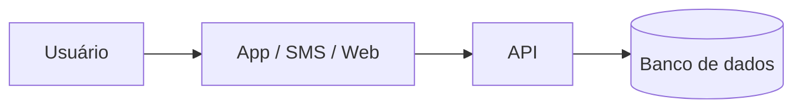

# PIST — Plataforma Integrada de Solicitações e Transparência: automação auditável de pedidos administrativos municipais com acompanhamento cidadão

## Integrantes

| Nome completo | GitHub | Área de carreira | RGM |
|---|---|---|---|
| Bruno Rodrigues | dev-rodrigues-bruno | Gestão | 48101541 |
| Caio Dal Pizzol Fonseca | Caio Fonseca | Cibersegurança e Gestão | 47923121 |
| Denner de Paula Coutinho | denner-coutinho | Engenharia de Dados e Gestão | 48094030 |
| João Vitor Pires Ribeiro | Joaovp07 | Ciência de Dados e Gestão | 47792591 |
| Nicollas Guedes Da Silva Santos | Nicollas-Guedes | Engenharia de Dados e Cloud | 48131334 |

**Dossiê:** 5 - Moderação automatizada e transparência 

**Recorte:** digitalização e automação, por regras auditáveis e com decisão final sempre humana, das solicitações administrativas de uma prefeitura, permitindo ao cidadão abrir e acompanhar o pedido online e à população consultar indicadores agregados de desempenho em um painel público. A implantação começa por um piloto em um único serviço municipal.

## 1. Análise do problema

### 1.1 Quem é afetado, onde e quanto

A moderação automatizada de conteúdo impacta diretamente bilhões de usuários de plataformas digitais globalmente e no Brasil, com efeitos desproporcionais sobre criadores de conteúdo, ativistas, minorias representativas e pequenos empreendedores.

* **Volume de Conteúdo Afetado:** Estima-se que as principais plataformas de redes sociais removam proativamente mais de 100 milhões de conteúdos por trimestre por meio de filtros automatizados. Contudo, relatórios de transparência decorrentes do *Digital Services Act (DSA)* revelam que centenas de milhares de decisões tomadas por IA envolvem falsos positivos diários.
* **Impacto no Brasil:** Pesquisas do *InternetLab* e do *CGI.br / NIC.br* apontam que usuários no Brasil enfrentam retenção indevida de contas e restrição silenciosa de alcance (*shadowbanning*) sem notificação detalhada. A super-moderação atinge desproporcionalmente o contra-discurso, a sátira e dialetos regionais.
* **Danos Econômicos e Liberdade de Expressão:** Empreendedores dependentes de comércio social perdem receitas imediatas ao sofrerem bloqueios de conta não fundamentados, enquanto o devido processo digital é cerceado pela ausência de canais de apelação eficientes.

### 1.2 Causas

As falhas de moderação automatizada decorrem de fatores estruturais e, prioritariamente, de escolhas e limitações arquiteturais de tecnologia:

1. **Efeito Caixa-Preta (*Black-Box*) dos Modelos:** O uso de redes profundas (NLP/LLMs) impede a rastreabilidade da decisão. O sistema classifica uma publicação como "violação de diretrizes", mas não fornece o motivo lógico ou o trecho exato.
2. **Vieses de Treinamento e Incompetência Contextual:** Algoritmos são treinados com conjuntos de dados (*datasets*) predominantemente anglófonos ou centralizados, incapazes de discernir ironia, linguagem figurada, gírias locais e ressignificação de termos.
3. **Limitações de Correspondência de Hash:** Filtros de assinaturas digitais (*hashes* exatas ou perceptuais) falham diante de conteúdos inéditos ou ligeiramente modificados e não avaliam o contexto em que a mídia foi compartilhada (ex: denúncia de um crime vs. apologia ao crime).
4. **Pipeline de Apelação Automatizado:** Para reduzir custos de operação, as plataformas utilizam os mesmos algoritmos classificadores para julgar os recursos dos usuários, eliminando a revisão humana qualificada.

### 1.3 O que já existe e por que não basta

* **Filtros de Heurística e Classificadores Nativos:** Plataformas utilizam algoritmos próprios baseados em inteligência artificial generativa e aprendizado de máquina para triagem em tempo real. **Por que não basta:** Operam sob segredo industrial, sem transparência algorítmica, auditoria externa ou explicabilidade ao usuário afetado.
* **Portais Legados de Denúncia:** Sistemas de notificação e retirada (*notice and take-down*) dependentes de denúncias de usuários. **Por que não basta:** Sofrem com coordenação de ataques (*brigading*), falta de feedback transparente sobre a decisão final e demora no processamento manual de apelações.
* **Estruturas de Autorregulação das Plataformas:** Conselhos de segurança e relatórios voluntários de transparência. **Por que não basta:** Apresentam métricas agregadas que escondem taxas reais de erro e falsos positivos, além de carecerem de conformidade com normativas de devido processo digital como o DSA europeu e as exigências em debate no PL 2630/2020 e Art. 19 do Marco Civil da Internet no Brasil.

## 2. Proposta tecnológica

### 2.1 A solução, do ponto de vista do usuário
[O que é, para quem, e como funciona passo a passo]

### 2.2 Arquitetura

[Que dados entram, onde ficam e quem acessa]

### 2.3 O trabalho de cada área

#### Engenharia de Dados

A Engenharia de Dados será responsável por organizar o ciclo de vida dos dados da plataforma. Definirá os modelos de dados, os padrões de qualidade, os processos de integração e a separação entre registros operacionais e dados destinados à análise pública. Também implementará pipelines para calcular indicadores, validar consistência e detectar duplicidades.

Entre suas entregas estão:
- modelo de dados para protocolos, etapas, unidades e prazos;
- rotinas de extração, transformação e carga (ETL);
- catálogo e dicionário de dados;
- regras de qualidade, rastreabilidade e atualização;
- mecanismos de agregação e anonimização para os painéis públicos.

#### Ciência de Dados

A Ciência de Dados poderá analisar dados agregados para identificar gargalos, sazonalidade, categorias com maior atraso e diferenças de desempenho entre unidades. Inicialmente, os indicadores serão descritivos e explicáveis; não será utilizado um modelo preditivo para decidir direitos ou negar solicitações.

Caso futuramente seja desenvolvido um modelo para estimar demanda ou prazo, ele deverá ser validado com dados representativos, ter suas limitações documentadas, ser monitorado para detectar distorções e servir apenas como apoio ao planejamento — nunca como substituto da decisão humana.

#### Cloud Computing

A área de Cloud Computing projetará uma infraestrutura escalável e resiliente, com ambientes separados de desenvolvimento, testes e produção. Será responsável por implantação automatizada, backups, recuperação de desastre, gestão de custos, disponibilidade e atualização dos serviços.

A proposta considera:
- infraestrutura como código;
- implantação contínua com revisão e testes;
- criptografia em trânsito e em repouso;
- backups periódicos e testes de restauração;
- monitoramento de disponibilidade, desempenho e custos;
- plano de continuidade e recuperação de desastre.

A adoção de nuvem não elimina a responsabilidade do órgão sobre segurança, privacidade, contratos e continuidade do serviço.

#### Cibersegurança

A Cibersegurança definirá e acompanhará controles para proteger dados, identidades, sistemas e documentos. Entre as atividades:
- análise de ameaças e avaliação de risco antes da implantação;
- autenticação forte para servidores e administradores;
- controle de acesso baseado em função e princípio do menor privilégio;
- gestão de vulnerabilidades, atualizações e segredos;
- testes de segurança e revisão de APIs;
- monitoramento de eventos e resposta a incidentes;
- proteção contra abuso, indisponibilidade e acesso indevido;
- plano de resposta e comunicação de incidentes.

#### Redes

A área de Redes garantirá conectividade segura entre os componentes e os sistemas externos. Planejará segmentação de rede, regras de firewall, proteção de interfaces públicas, VPN ou conexão privada quando aplicável, redundância e monitoramento. Também apoiará a disponibilidade dos canais e a comunicação entre unidades administrativas.

#### Gestão

A Gestão será responsável pelo mapeamento dos processos atuais, pela definição dos serviços prioritários e pela revisão das regras administrativas antes de automatizá-las. Coordenará servidores, tecnologia, atendimento ao cidadão, jurídico, acessibilidade e proteção de dados.

Suas atribuições incluem:
- mapear processos e eliminar etapas desnecessárias;
- definir responsáveis, prazos e níveis de serviço;
- elaborar plano de implantação gradual;
- capacitar servidores e equipes de atendimento;
- acompanhar indicadores e promover melhoria contínua;
- organizar consulta pública e testes com usuários;
- garantir orçamento, governança e manutenção após o primeiro ano.

#### Como as áreas se complementam

A Gestão define o processo e os objetivos; Engenharia de Dados garante dados consistentes; Ciência de Dados transforma dados agregados em análises úteis; Cloud sustenta a plataforma; Redes assegura conectividade; e Cibersegurança protege o ambiente. As áreas trabalham em conjunto desde o levantamento de requisitos até a operação, com revisões técnicas e éticas em cada etapa. A transparência depende tanto de arquitetura e qualidade dos dados quanto de processos administrativos claros e servidores preparados.

### 2.4 O que a tecnologia não resolve

A plataforma pode reduzir trabalho repetitivo e melhorar o acompanhamento, mas não resolve sozinha problemas institucionais ou sociais. Permanecem dependentes de ação humana e de políticas públicas:

- **Decisões administrativas:** deferir, indeferir ou priorizar pedidos que envolvam análise de mérito ou direitos exige autoridade competente e justificativa.
- **Revisão de processos:** automatizar um procedimento burocrático sem redesenhá-lo pode apenas digitalizar a burocracia existente.
- **Inclusão digital:** pessoas sem internet, dispositivo, alfabetização digital ou recursos de acessibilidade precisam de atendimento presencial ou assistido.
- **Transparência efetiva:** divulgar números não substitui explicar decisões, publicar informações em linguagem clara e responder a pedidos de acesso à informação.
- **Qualidade dos dados:** a plataforma depende de registros completos e corretos; dados ruins geram indicadores enganosos.
- **Capacidade institucional:** falta de servidores, orçamento ou coordenação pode manter atrasos mesmo com automação.
- **Confiança pública:** será construída por prestação de contas, participação social, proteção de dados e correção de falhas.
- **Mudanças normativas:** regras e prazos precisam ser atualizados pelos responsáveis, não presumidos pelo sistema.

Por isso, a implantação deve ser gradual, com piloto em um serviço específico, avaliação de resultados e possibilidade de revisão ou interrupção caso os controles não sejam suficientes.

## 3. Análise ética

A plataforma PIST deve garantir segurança, privacidade e transparência no tratamento das informações dos cidadãos. A automação será utilizada para auxiliar os servidores, sem substituir a decisão humana.

### 3.1 Matriz de riscos

| # | Risco | Classificação | Impacto | Controle |
|---|---|---|---|---|
| 1 | Vazamento de dados pessoais | Segurança / Legal-privacidade | Exposição de informações dos cidadãos. | Criptografia e controle de acesso. |
| 2 | Classificação incorreta dos pedidos | Ético / Viés-inclusão | Atrasos no atendimento. | Revisão por servidores. |
| 3 | Falta de transparência | Ético / Governança | Cidadão sem informações sobre seu pedido. | Histórico e status disponíveis. |
| 4 | Acesso indevido ao sistema | Segurança | Consulta ou alteração de dados sem autorização. | Autenticação e registro de acessos. |
| 5 | Exclusão digital | Viés-inclusão / Ético | Dificuldade de acesso para parte da população. | Manter atendimento presencial e interface acessível. |
| 6 | Decisões somente automatizadas | Ético / Governança | Cidadãos prejudicados por erros do sistema. | Aprovação humana nas decisões administrativas. |

### 3.2 Decisão

**Implantar com controles**

A plataforma pode melhorar os serviços municipais, facilitar solicitações e aumentar a transparência. Porém, sua implantação depende de medidas de segurança, proteção de dados e revisão humana. O projeto deverá começar com um serviço piloto, permitindo identificar e corrigir problemas antes de sua expansão.

### 3.3 Controles antes de entrar em produção

| Eixo | Controle | Quem faz | Como saber que foi cumprido |
|---|---|---|---|
| Transparência | Informar como o sistema utiliza os dados. | Gestão | Aviso de privacidade publicado. |
| Revisão humana | Garantir decisões finais por servidores. | Prefeitura | Fluxo de aprovação testado. |
| Minimização de dados | Coletar somente dados necessários. | Desenvolvimento | Formulários revisados. |
| Segurança | Proteger acessos e informações. | Cibersegurança | Testes de segurança realizados. |
| Teste de viés | Verificar erros e possíveis discriminações. | Dados e gestão | Resultados documentados. |
| Canal de contestação | Permitir questionamentos dos cidadãos. | Prefeitura | Canal disponível e funcionando. |

### 3.4 LGPD

A plataforma deverá seguir a Lei Geral de Proteção de Dados (Lei nº 13.709/2018), coletando apenas informações necessárias e garantindo seu armazenamento seguro.

| Dado pessoal | Finalidade | Base legal | Por quanto tempo | Sensível ou de criança/adolescente? |
|---|---|---|---|---|
| Nome completo | Identificar o cidadão. | Art. 7º, III, quando aplicável. | Conforme regras de conservação documental. | Não. |
| CPF | Confirmar identidade, quando necessário. | Art. 7º, III, quando aplicável. | Conforme necessidade e obrigações legais. | Não. |
| E-mail e telefone | Enviar atualizações. | Art. 7º, III, quando aplicável. | Enquanto necessários para o atendimento. | Não. |
| Endereço | Verificar localização, quando necessário. | Art. 7º, III, quando aplicável. | Conforme necessidade do serviço. | Não. |
| Solicitação e anexos | Analisar o pedido. | Arts. 7º, 11 e 23, conforme o dado e a finalidade. | Conforme regras de conservação documental. | Podem conter. |

**Observação:** dados sensíveis ou de menores deverão receber proteção adicional. O painel público apresentará apenas indicadores agregados, sem identificar os cidadãos.

### 3.5 Comunicado público

> A PIST facilita o acesso aos serviços municipais, permitindo que os cidadãos registrem solicitações e acompanhem seu andamento pela internet. A tecnologia auxilia na organização dos pedidos, mas as decisões finais continuam sob responsabilidade dos servidores. As informações pessoais serão protegidas conforme a LGPD, e a população poderá consultar indicadores públicos de transparência.

**Contagem:** aproximadamente 430 caracteres.

**Contagem:** [N] caracteres

## 4. Acessibilidade e inclusão digital

O PIST nasce digital, mas o público de uma prefeitura é a população inteira, inclusive quem não está (ou está mal) conectado. Os números mostram que o problema não é só ter internet, e sim saber usá-la para resolver a vida:

Em 2025, 90,5% das pessoas com 10 anos ou mais usaram a internet, mas entre pessoas sem instrução só 50,1% usaram. Entre os idosos, o índice foi de 74,5%, e 66,5% dos idosos desconectados apontam como motivo não saber usar. Cerca de 4 milhões de domicílios seguem sem internet e 19,1 milhões de pessoas não têm celular próprio (IBGE, 2026).
O celular é o meio de acesso de 98,7% dos usuários, e apenas 41,1% usaram serviços públicos pela internet (IBGE, 2026). No acesso móvel, predominam planos pré-pagos, sobretudo nas classes D e E (CGI.br, 2025), ou seja, franquia de dados curta.
O Brasil tem 14,4 milhões de pessoas com deficiência (7,3% da população com 2 anos ou mais); 45,4% delas são idosas, 7,9 milhões têm dificuldade para enxergar e a taxa de analfabetismo entre pessoas com deficiência de 15 anos ou mais é de 21,3% (IBGE, 2025).
29% da população de 15 a 64 anos é analfabeta funcional, chegando a 51% na faixa de 50 a 64 anos (Inaf, 2025).

Por isso a regra de projeto é: o canal digital é uma porta a mais, nunca a única. Ninguém perde prazo, prioridade ou direito por pedir pelo balcão ou pelo telefone, o que também atende à Lei do Governo Digital (Lei 14.129/2021), que garante o atendimento presencial, e à Lei Brasileira de Inclusão (Lei 13.146/2015).

### 4.1 Quem pode ficar de fora

A plataforma deverá seguir a Lei Brasileira de Inclusão (Lei nº 13.146/2015) e a Lei do Governo Digital (Lei nº 14.129/2021), mantendo o atendimento presencial e oferecendo alternativas para quem tem dificuldade de usar o canal digital.

| Grupo | Barreira | O que a solução faz |
|---|---|---|
| Pessoas sem smartphone ou sem internet | Não conseguem abrir nem acompanhar o pedido online. | Atendimento assistido no balcão, com protocolo impresso e acompanhamento por SMS ou telefone, na mesma fila do canal digital. |
| Pessoas com plano pré-pago ou conexão fraca | Páginas pesadas consomem a franquia e não carregam. | Páginas leves, funcionamento em 3G, rascunho salvo automaticamente e avisos por SMS. |
| Pessoas idosas | Pouca familiaridade digital e dificuldade de visão ou coordenação. | Fluxo curto, letras e botões grandes, botão "Falar com uma pessoa", pedido aberto por familiar ou procurador e oficinas presenciais. |
| Pessoas cegas ou com baixa visão | Telas incompatíveis com leitor de tela, baixo contraste e informação só em cor ou gráfico. | Conformidade com a WCAG 2.2 nível AA, testes com leitores de tela e tabela equivalente para cada gráfico do painel. |
| Pessoas surdas | Atendimento só por telefone e vídeos sem tradução. | Canal escrito (chat e SMS), VLibras nas páginas e legenda nos vídeos. |
| Pessoas com deficiência motora | Dificuldade com mouse, toque preciso e limites de tempo. | Navegação completa por teclado, alvos de toque grandes e aviso antes de a sessão expirar. |
| Pessoas com baixa escolaridade | Formulários, termos técnicos e mensagens de erro difíceis de entender. | Linguagem simples, ícones com texto, uma pergunta por vez, leitura em voz alta e atendimento humano. |
| Pessoas sem conta gov.br prata ou ouro | Login complexo pode impedir o primeiro acesso. | Acesso com CPF e código por SMS; gov.br exigido só quando a lei pedir identificação forte. |

## 4.2 Requisitos de acessibilidade

A referência técnica é a WCAG 2.2, nível AA (W3C, 2024), complementada pelo eMAG (Modelo de Acessibilidade em Governo Eletrônico), que é o padrão dos órgãos públicos brasileiros. Cada requisito abaixo vira critério de aceite: a funcionalidade só vai para produção se passar.

#	Requisito concreto no PIST	Critério WCAG 2.2
* R1	Todo ícone, imagem e botão gráfico tem texto alternativo; os gráficos do painel público têm tabela de dados equivalente	1.1.1 Conteúdo não textual (A)
* R2	O formulário usa rótulos reais (<label>), títulos em ordem lógica e campos agrupados, para o leitor de tela entender a estrutura	1.3.1 Informações e relações (A); 3.3.2 Rótulos ou instruções (A)
* R3	O status do pedido nunca é indicado só por cor (ex.: "Em análise" escrito, não só um ponto amarelo)	1.4.1 Uso de cor (A)
* R4	Contraste mínimo de 4,5:1 para texto e 3:1 para bordas de campos, botões e ícones	1.4.3 Contraste mínimo (AA); 1.4.11 Contraste não textual (AA)
* R5	A página funciona com o texto ampliado em 200% e em tela de 320 px de largura sem rolagem horizontal	1.4.4 Redimensionar texto (AA); 1.4.10 Refluxo (AA)
* R6	Todas as funções (abrir, anexar, acompanhar, contestar) funcionam só pelo teclado, com foco sempre visível e nunca escondido por banners ou cabeçalhos fixos	2.1.1 Teclado (A); 2.4.7 Foco visível (AA); 2.4.11 Foco não obscurecido (AA)
* R7	Botões e links com área de toque de no mínimo 24 × 24 px (o projeto adota 44 × 44 px para facilitar o uso por idosos)	2.5.8 Tamanho do alvo – mínimo (AA)
* R8	A sessão avisa antes de expirar e permite estender o tempo; o rascunho é salvo	2.2.1 Tempo ajustável (A)
* R9	Erros são explicados em texto, com a sugestão de correção ("O CPF tem 11 números; faltam 2")	3.3.1 Identificação do erro (A); 3.3.3 Sugestão de erro (AA)
* R10	O sistema não pede de novo um dado já informado no mesmo pedido (endereço, telefone)	3.3.7 Entrada redundante (A)
* R11	O login não exige teste cognitivo (sem CAPTCHA de quebra-cabeça e sem memorizar senha); usa código por SMS ou gov.br, com colar/preencher automático liberado	3.3.8 Autenticação acessível – mínimo (AA)
* R12	O botão "Falar com uma pessoa" e o telefone de ajuda aparecem sempre no mesmo lugar em todas as telas	3.2.6 Ajuda consistente (A)
* R13	Mudanças de status e mensagens de "pedido enviado" são anunciadas pelo leitor de tela sem mudar o foco	4.1.3 Mensagens de status (AA)
* R14	Componentes personalizados (menus, abas, upload) expõem nome, função e estado corretos para tecnologias assistivas	4.1.2 Nome, função, valor (A)
* R15	Textos escritos para leitura até o nível do ensino fundamental, revisados com usuários de baixa escolaridade (meta além do AA)

## 5. Sustentabilidade

### 5.1 Impacto ambiental da solução

O processamento de Inteligência Artificial para moderação em larga escala impõe uma expressiva pegada ecológica que demanda estratégias de *Green AI*:

* **Consumo Energético de Data Centers:** A inferência contínua em tempo real usando modelos de grande porte (LLMs) gera consumo elétrico intensivo e altas emissões de CO₂ em infraestruturas de nuvem.
* **Pegada Hídrica e Descarte de Hardware (E-Waste):** O resfriamento de servidores de GPU/TPU consome recursos hídricos significativos, enquanto a rápida substituição de hardware de aceleração acelera o acúmulo de lixo eletrônico.
* **Escolhas Tecnológicas de TI Verde para Mitigação:**
* **Arquitetura de Filtragem em Camadas:** Uso de algoritmos de baixo custo energético (*hashing* e regras heurísticas) na primeira etapa de triagem, acionando modelos complexos de NLP/LLM apenas para conteúdos limítrofes.
* **Destilação de Modelos (*Model Distillation*):** Emprego de modelos compactos (*Small Language Models* - SLMs) otimizados para inferência local com redução de até 90% no consumo energético por requisição.
* **Provedores com Energia Renovável:** Hospedagem em data centers com certificação PUE (*Power Usage Effectiveness*) otimizada e alimentados por fontes 100% renováveis.

### 5.2 Sustentabilidade do projeto

A perenidade da solução envolve sustentabilidade operacional, financeira e humana:

* **Quem Mantém:** Equipe técnica multidisciplinar composta por Engenheiros de Dados (manutenção do pipeline e *datasets*), Especialistas em Cibersegurança/Privacidade (conformidade LGPD e auditoria de APIs) e Moderadores Humanos de apoio para casos de apelação.
* **Sustentabilidade Humana e Social:** Estabelecimento de jornadas de trabalho controladas, rotação de tarefas e suporte de saúde mental contínuo para revisores humanos terceirizados, evitando a superexposição a conteúdos nocivos e garantindo o trabalho digno na cadeia de suprimentos de IA.
* **Modelo Financeiro:** Custeio viabilizado por taxa de governança de conformidade cobrada de plataformas integradas, fundos institucionais de fomento à transparência algorítmica ou parcerias público-privadas de interesse social.
* **Após o Primeiro Ano:** Transição para um modelo de governança aberta e multissetorial (*open-source* com API de auditoria para pesquisadores acadêmicos do Data Privacy Brasil, InternetLab e ITS Rio), garantindo atualizações contínuas de segurança e reavaliação periódica dos modelos de viés.

## 6. Impacto esperado

O piloto roda em um único serviço municipal durante 12 meses. Antes de ligar o PIST, a equipe mede por 3 meses a linha de base do processo atual (tempo de resposta, volume por canal, reclamações na ouvidoria), para que toda meta abaixo seja comparada com a situação real e não com uma estimativa.

### 6.1 Indicadores

Os indicadores serão medidos a partir dos registros do próprio PIST e comparados à linha de base do processo atual, com os resultados publicados no painel público.

| Indicador | Como medir | Meta | Prazo |
|---|---|---|---|
| Tempo médio de resposta | Intervalo entre a abertura e a resposta final, registrado no PIST. | Redução de 40%. | 6 meses. |
| Pedidos dentro do prazo | Percentual de pedidos concluídos no prazo do serviço. | No mínimo 90%. | 6 meses. |
| Adesão ao canal digital | Percentual de pedidos abertos online. | No mínimo 50%, sem reduzir o atendimento presencial. | 12 meses. |
| Conclusão do formulário | Pedidos enviados divididos pelos pedidos iniciados. | No mínimo 80%. | 3 meses. |
| Equidade entre canais | Diferença no tempo de resposta entre pedidos do balcão e online. | No máximo 10%. | 6 meses. |
| Satisfação do cidadão | Nota de 1 a 5 ao final do atendimento, em todos os canais. | Média mínima de 4, também entre pessoas 60+ e com deficiência. | 6 meses. |
| Qualidade da automação | Percentual de encaminhamentos corrigidos e de decisões revertidas. | Correções até 10% e reversões até 5%. | Mensal, a partir do 3º mês. |
| Resposta às contestações | Tempo entre a contestação e a resposta humana. | Até 10 dias úteis. | 3 meses. |
| Acessibilidade | Erros críticos nos testes da WCAG 2.2 AA. | Zero em cada versão publicada. | Contínuo. |
| Reclamações na ouvidoria | Registros da ouvidoria sobre o serviço piloto. | Redução de 30%. | 12 meses. |
| Atualização do painel público | Atraso entre o registro do dado e sua publicação. | Até 7 dias. | 3 meses. |
| Disponibilidade do sistema | Monitoramento de funcionamento (uptime). | No mínimo 99,5% ao mês. | Contínuo. |

## 6.2 Como os usuários serão ouvidos

A escuta acontece em quatro momentos, antes de qualquer decisão de ampliar o PIST para outros serviços:

Antes do piloto (descoberta): entrevistas com cerca de 20 cidadãos que já usaram o serviço escolhido (presencialmente e por telefone) e com os servidores que o operam, para mapear onde o processo trava. Os protótipos de tela são testados com o mesmo público descrito na seção 4.
Durante o piloto (contínuo): pesquisa de satisfação de uma pergunta ao final de cada atendimento, em todos os canais, com campo aberto para comentário; botão "Isto foi útil?" nas páginas; relatos de barreiras de acessibilidade pela declaração de acessibilidade; e os registros da ouvidoria.
Oficinas presenciais trimestrais em CRAS, bibliotecas e centros de convivência, para ouvir justamente quem usa pouco o canal digital, com apoio dos conselhos municipais da pessoa idosa e da pessoa com deficiência, que participam também como comitê consultivo do projeto.
Revisão de 12 meses: relatório público com os resultados, o que mudou a partir das sugestões recebidas e o que não foi possível mudar (e por quê).

Critério para ampliar: o PIST só vai para um segundo serviço se, ao final do piloto, a maior parte das metas da tabela 6.1 tiver sido atingida e nenhum grupo da seção 4.1 estiver em situação pior do que antes (satisfação menor ou tempo de resposta maior que o dos demais).

### 6.3 Se a solução não pegar

Caso a adesão ou os resultados fiquem abaixo do esperado, o atendimento presencial continuará funcionando normalmente e o PIST só será ampliado depois de corrigidos os problemas.

| Risco | Sinal de alerta | O que fazer |
|---|---|---|
| Baixa adesão ao canal digital | Menos de 20% dos pedidos online em 6 meses. | Investigar os motivos, simplificar o fluxo e divulgar em rádios comunitárias, UBS e escolas. |
| Resistência dos servidores | Pedidos tratados fora do PIST ou com registro incompleto. | Envolver os servidores no desenho, treinar no horário de trabalho e ter um servidor de referência por setor. |
| Erros da automação | Correções acima de 10% ou reversões acima de 5%. | Suspender a regra com problema, voltar à triagem manual e publicar o ocorrido no painel. |
| Exclusão de grupos vulneráveis | Satisfação ou tempo de resposta pior para pessoas 60+, com deficiência ou atendidas no balcão. | Priorizar a correção antes de novas funções e reforçar o atendimento assistido. |
| Falta de orçamento ou troca de gestão | Corte de verba ou mudança de prioridades. | Manter código aberto, documentação completa e resultados publicados para justificar a continuidade. |
| Metas não atingidas em 12 meses | Principais indicadores abaixo da meta mesmo após ajustes. | Não ampliar, manter o que funcionou e publicar as lições aprendidas. |

## 7. Quadro de decisões (mínimo 5)

| Decisão | Alternativas consideradas | Por que escolhemos esta |
|---|---|---|
| | | |

## 8. Capítulos individuais

### 8.1 [Nome do integrante] — [Área]

**Papel no projeto:** [pelo que respondeu e o que produziu]

**Plano de desenvolvimento**

| Competência que a solução exige | Técnica ou comportamental | Já tenho? |
|---|---|---|
| | | |

**Metas SMART (6 a 12 meses)**
1. [Específica, mensurável, atingível, relevante e com prazo]

**Feedback dos colegas**
[Avaliação construtiva e propositiva, escrita em conjunto pelos demais integrantes]

### 8.2 [Próximo integrante] — [Área]
### 8.3 [Próximo integrante] — [Área]
### 8.4 [Próximo integrante (se houver)] — [Área]
### 8.5 [Próximo integrante (se houver)] — [Área]

## 9. Referências
* CGI.br / NIC.br. *Sistematização da Consulta Pública sobre Regulação de Plataformas Digitais*. Comitê Gestor da Internet no Brasil, dezembro de 2024. [https://www.cgi.br/](https://www.cgi.br/)
* DATA PRIVACY BRASIL. *Asymmetries of Information and Algorithmic Governance in Content Moderation*. Associação de Pesquisa Data Privacy Brasil, novembro de 2024. [https://www.dataprivacybr.org/](https://www.dataprivacybr.org/)
* INTERNETLAB. *Pesquisa em Moderação de Conteúdo, Direitos Digitais e Liberdade de Expressão*. InternetLab, março de 2025. [https://internetlab.org.br/](https://internetlab.org.br/)
* ITS RIO. *Governança de Plataformas Digitais e Transparência Algorítmica*. Instituto de Tecnologia e Sociedade do Rio de Janeiro, 2025. [https://itsrio.org/](https://itsrio.org/)
* SCHWARTZ, Roy et al. *Green AI e Eficiência Energética em LLMs - Revisão Atualizada*. Communications of the ACM, 2025. [https://dl.acm.org/](https://dl.acm.org/)
* UNIÃO EUROPEIA. *Digital Services Act (DSA) - Relatórios de Transparência e Implementação*. Jornal Oficial da União Europeia, 2024. [https://eur-lex.europa.eu/](https://eur-lex.europa.eu/)
* BRASIL. **Lei nº 13.709, de 14 de agosto de 2018 — Lei Geral de Proteção de Dados Pessoais (LGPD)**. Presidência da República, 2018. [https://www.planalto.gov.br/ccivil_03/_ato2015-2018/2018/lei/l13709.htm](https://www.planalto.gov.br/ccivil_03/_ato2015-2018/2018/lei/l13709.htm)

* ANPD. **Guia Orientativo: Tratamento de Dados Pessoais pelo Poder Público**. Autoridade Nacional de Proteção de Dados. [https://www.gov.br/anpd/pt-br/centrais-de-conteudo/materiais-educativos-e-publicacoes/guia_orientativo_tratamento_de_dados_pessoais_pelo_poder_publico](https://www.gov.br/anpd/pt-br/centrais-de-conteudo/materiais-educativos-e-publicacoes/guia_orientativo_tratamento_de_dados_pessoais_pelo_poder_publico)

* BRASIL. **Lei nº 12.527, de 18 de novembro de 2011 — Lei de Acesso à Informação (LAI)**. Presidência da República, 2011. [https://www.planalto.gov.br/ccivil_03/_ato2011-2014/2011/lei/l12527.htm](https://www.planalto.gov.br/ccivil_03/_ato2011-2014/2011/lei/l12527.htm)

*  BRASIL. Ministério da Gestão e da Inovação em Serviços Públicos. **Automação de Serviços**. Governo Digital. Disponível em: [https://www.gov.br/governodigital/pt-br/estrategias-e-governanca-digital/transformacao-digital/ferramentas/automacao-de-servicos/automacao-de-servicos.]

* BRASIL. Ministério da Gestão e da Inovação em Serviços Públicos. **Plano de Transformação Digital (PTD)**. Governo Digital, 16 maio 2024. Disponível em: [https://www.gov.br/governodigital/pt-br/estrategias-e-governanca-digital/sisp/guia-do-gestor/guia-orientativo-de-padroes-e-fluxos-das-tecnologias-de-transformacao-digital/plano-de-transformacao-digital-ptd.]

* BRASIL. Ministério da Gestão e da Inovação em Serviços Públicos. **Lei do Governo Digital**. Disponível em: [https://www.gov.br/governodigital/pt-br/legislacao/lei-do-governo-digital.]

* BRASIL. Autoridade Nacional de Proteção de Dados. **Guia orientativo: Tratamento de dados pessoais pelo Poder Público**. Publicado em 22 nov. 2024; modificado em 23 jan. 2025. Disponível em: [https://www.gov.br/anpd/pt-br/centrais-de-conteudo/materiais-educativos-e-publicacoes/guia_orientativo_tratamento_de_dados_pessoais_pelo_poder_publico.]

* W3C. **Web Content Accessibility Guidelines (WCAG) 2.2**. Recomendação de 12 dez. 2024. Disponível em: [https://www.w3.org/TR/wcag/.]
