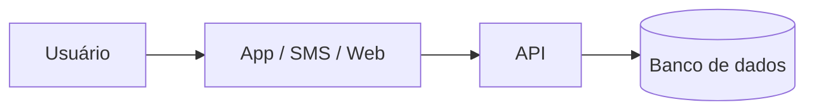

# PIST — Plataforma Integrada de Solicitações e Transparência: automação auditável de pedidos administrativos municipais com acompanhamento cidadão

## Integrantes

* Bruno Rodrigues | dev-rodrigues-bruno | Gestão | 48101541  
* Caio Dal Pizzol Fonseca | caio-fonseca | Cibersegurança e Gestão | 47923121
* Denner de Paula Coutinho | denner-coutinho | Engenharia de Dados e Gestão | 48094030
* João Vitor Pires Ribeiro | Joaovp07 | Ciência de Dados e Gestão | 47792591
* Nicollas Guedes Da Silva Santos | Nicollas-Guedes | Engenharia de Dados e Cloud | 48131334

**Dossiê:** 5 - Moderação automatizada e transparência 

**Recorte:** digitalização e automação, por regras auditáveis e com decisão final sempre humana, das solicitações administrativas de uma prefeitura, permitindo ao cidadão abrir e acompanhar o pedido online e à população consultar indicadores agregados de desempenho em um painel público. A implantação começa por um piloto em um único serviço municipal.

## 1. Análise do problema

### 1.1 Quem é afetado, onde e quanto

A moderação automatizada de conteúdo impacta diretamente bilhões de usuários de plataformas digitais globalmente e no Brasil, com efeitos desproporcionais sobre criadores de conteúdo, ativistas, minorias representativas e pequenos empreendedores.

* **Volume de Conteúdo Afetado:** Estima-se que as principais plataformas de redes sociais removam proativamente mais de 100 milhões de conteúdos por trimestre por meio de filtros automatizados. Contudo, relatórios de transparência decorrentes do *Digital Services Act (DSA)* revelam que centenas de milhares de decisões tomadas por IA envolvem falsos positivos diários.
* **Impacto no Brasil:** Pesquisas do *InternetLab* e do *CGI.br / NIC.br* apontam que usuários no Brasil enfrentam retenção indevida de contas e restrição silenciosa de alcance (*shadowbanning*) sem notificação detalhada. A super-moderação atinge desproporcionalmente o contra-discurso, a sátira e dialetos regionais.
* **Danos Econômicos e Liberdade de Expressão:** Empreendedores dependentes de comércio social perdem receitas imediatas ao sofrerem bloqueios de conta não fundamentados, enquanto o devido processo digital é cerceado pela ausência de canais de apelação eficientes.

### 1.2 Causas

As falhas de moderação automatizada decorrem de fatores estruturais e, prioritariamente, de escolhas e limitações arquiteturais de tecnologia:

1. **Efeito Caixa-Preta (*Black-Box*) dos Modelos:** O uso de redes profundas (NLP/LLMs) impede a rastreabilidade da decisão. O sistema classifica uma publicação como "violação de diretrizes", mas não fornece o motivo lógico ou o trecho exato.
2. **Vieses de Treinamento e Incompetência Contextual:** Algoritmos são treinados com conjuntos de dados (*datasets*) predominantemente anglófonos ou centralizados, incapazes de discernir ironia, linguagem figurada, gírias locais e ressignificação de termos.
3. **Limitações de Correspondência de Hash:** Filtros de assinaturas digitais (*hashes* exatas ou perceptuais) falham diante de conteúdos inéditos ou ligeiramente modificados e não avaliam o contexto em que a mídia foi compartilhada (ex: denúncia de um crime vs. apologia ao crime).
4. **Pipeline de Apelação Automatizado:** Para reduzir custos de operação, as plataformas utilizam os mesmos algoritmos classificadores para julgar os recursos dos usuários, eliminando a revisão humana qualificada.

### 1.3 O que já existe e por que não basta

* **Filtros de Heurística e Classificadores Nativos:** Plataformas utilizam algoritmos próprios baseados em inteligência artificial generativa e aprendizado de máquina para triagem em tempo real. **Por que não basta:** Operam sob segredo industrial, sem transparência algorítmica, auditoria externa ou explicabilidade ao usuário afetado.
* **Portais Legados de Denúncia:** Sistemas de notificação e retirada (*notice and take-down*) dependentes de denúncias de usuários. **Por que não basta:** Sofrem com coordenação de ataques (*brigading*), falta de feedback transparente sobre a decisão final e demora no processamento manual de apelações.
* **Estruturas de Autorregulação das Plataformas:** Conselhos de segurança e relatórios voluntários de transparência. **Por que não basta:** Apresentam métricas agregadas que escondem taxas reais de erro e falsos positivos, além de carecerem de conformidade com normativas de devido processo digital como o DSA europeu e as exigências em debate no PL 2630/2020 e Art. 19 do Marco Civil da Internet no Brasil.

## 2. Proposta tecnológica

### 2.1 A solução, do ponto de vista do usuário
[O que é, para quem, e como funciona passo a passo]

### 2.2 Arquitetura

[Que dados entram, onde ficam e quem acessa]

### 2.3 O trabalho de cada área

#### [Área 1]
#### [Área 2]
#### Como as áreas se complementam

### 2.4 O que a tecnologia não resolve

## 3. Análise ética

### 3.1 Matriz de riscos (mínimo 5)

| # | Risco | Classificação | Impacto (quem e quão grave) | Controle |
|---|---|---|---|---|
| 1 | | [ético / legal-privacidade / segurança / viés-inclusão / governança] | | |

### 3.2 Decisão
**[Implantar | Implantar com controles | Não implantar ainda]**
[Justificativa em até 10 linhas]

### 3.3 Controles antes de entrar em produção

| Eixo | Controle | Quem faz | Como saber que foi cumprido |
|---|---|---|---|
| Transparência | | | |
| Revisão humana | | | |
| Minimização de dados | | | |
| Segurança | | | |
| Teste de viés | | | |
| Canal de contestação | | | |

### 3.4 LGPD

| Dado pessoal | Finalidade | Base legal | Por quanto tempo | Sensível ou de criança/adolescente? |
|---|---|---|---|---|
| | | | | |

### 3.5 Comunicado público

> [Texto de até 600 caracteres para o LinkedIn da consultoria]

**Contagem:** [N] caracteres

## 4. Acessibilidade e inclusão digital

### 4.1 Quem pode ficar de fora

| Grupo | Barreira | O que a solução faz |
|---|---|---|
| | | |

### 4.2 Requisitos de acessibilidade
[Requisitos concretos, com o critério WCAG correspondente]

## 5. Sustentabilidade

### 5.1 Impacto ambiental da solução

O processamento de Inteligência Artificial para moderação em larga escala impõe uma expressiva pegada ecológica que demanda estratégias de *Green AI*:

* **Consumo Energético de Data Centers:** A inferência contínua em tempo real usando modelos de grande porte (LLMs) gera consumo elétrico intensivo e altas emissões de CO₂ em infraestruturas de nuvem.
* **Pegada Hídrica e Descarte de Hardware (E-Waste):** O resfriamento de servidores de GPU/TPU consome recursos hídricos significativos, enquanto a rápida substituição de hardware de aceleração acelera o acúmulo de lixo eletrônico.
* **Escolhas Tecnológicas de TI Verde para Mitigação:**
* **Arquitetura de Filtragem em Camadas:** Uso de algoritmos de baixo custo energético (*hashing* e regras heurísticas) na primeira etapa de triagem, acionando modelos complexos de NLP/LLM apenas para conteúdos limítrofes.
* **Destilação de Modelos (*Model Distillation*):** Emprego de modelos compactos (*Small Language Models* - SLMs) otimizados para inferência local com redução de até 90% no consumo energético por requisição.
* **Provedores com Energia Renovável:** Hospedagem em data centers com certificação PUE (*Power Usage Effectiveness*) otimizada e alimentados por fontes 100% renováveis.

### 5.2 Sustentabilidade do projeto

A perenidade da solução envolve sustentabilidade operacional, financeira e humana:

* **Quem Mantém:** Equipe técnica multidisciplinar composta por Engenheiros de Dados (manutenção do pipeline e *datasets*), Especialistas em Cibersegurança/Privacidade (conformidade LGPD e auditoria de APIs) e Moderadores Humanos de apoio para casos de apelação.
* **Sustentabilidade Humana e Social:** Estabelecimento de jornadas de trabalho controladas, rotação de tarefas e suporte de saúde mental contínuo para revisores humanos terceirizados, evitando a superexposição a conteúdos nocivos e garantindo o trabalho digno na cadeia de suprimentos de IA.
* **Modelo Financeiro:** Custeio viabilizado por taxa de governança de conformidade cobrada de plataformas integradas, fundos institucionais de fomento à transparência algorítmica ou parcerias público-privadas de interesse social.
* **Após o Primeiro Ano:** Transição para um modelo de governança aberta e multissetorial (*open-source* com API de auditoria para pesquisadores acadêmicos do Data Privacy Brasil, InternetLab e ITS Rio), garantindo atualizações contínuas de segurança e reavaliação periódica dos modelos de viés.

## 6. Impacto esperado

### 6.1 Indicadores

| Indicador | Como medir | Meta | Prazo |
|---|---|---|---|
| | | | |

### 6.2 Como os usuários serão ouvidos
### 6.3 Se a solução não pegar

## 7. Quadro de decisões (mínimo 5)

| Decisão | Alternativas consideradas | Por que escolhemos esta |
|---|---|---|
| | | |

## 8. Capítulos individuais

### 8.1 [Nome do integrante] — [Área]

**Papel no projeto:** [pelo que respondeu e o que produziu]

**Plano de desenvolvimento**

| Competência que a solução exige | Técnica ou comportamental | Já tenho? |
|---|---|---|
| | | |

**Metas SMART (6 a 12 meses)**
1. [Específica, mensurável, atingível, relevante e com prazo]

**Feedback dos colegas**
[Avaliação construtiva e propositiva, escrita em conjunto pelos demais integrantes]

### 8.2 [Próximo integrante] — [Área]
### 8.3 [Próximo integrante] — [Área]
### 8.4 [Próximo integrante (se houver)] — [Área]
### 8.5 [Próximo integrante (se houver)] — [Área]

## 9. Referências
* CGI.br / NIC.br. *Sistematização da Consulta Pública sobre Regulação de Plataformas Digitais*. Comitê Gestor da Internet no Brasil, dezembro de 2024. [https://www.cgi.br/](https://www.cgi.br/)
* DATA PRIVACY BRASIL. *Asymmetries of Information and Algorithmic Governance in Content Moderation*. Associação de Pesquisa Data Privacy Brasil, novembro de 2024. [https://www.dataprivacybr.org/](https://www.dataprivacybr.org/)
* INTERNETLAB. *Pesquisa em Moderação de Conteúdo, Direitos Digitais e Liberdade de Expressão*. InternetLab, março de 2025. [https://internetlab.org.br/](https://internetlab.org.br/)
* ITS RIO. *Governança de Plataformas Digitais e Transparência Algorítmica*. Instituto de Tecnologia e Sociedade do Rio de Janeiro, 2025. [https://itsrio.org/](https://itsrio.org/)
* SCHWARTZ, Roy et al. *Green AI e Eficiência Energética em LLMs - Revisão Atualizada*. Communications of the ACM, 2025. [https://dl.acm.org/](https://dl.acm.org/)
* UNIÃO EUROPEIA. *Digital Services Act (DSA) - Relatórios de Transparência e Implementação*. Jornal Oficial da União Europeia, 2024. [https://eur-lex.europa.eu/](https://eur-lex.europa.eu/)
* BRASIL. **Lei nº 13.709, de 14 de agosto de 2018 — Lei Geral de Proteção de Dados Pessoais (LGPD)**. Presidência da República, 2018. [https://www.planalto.gov.br/ccivil_03/_ato2015-2018/2018/lei/l13709.htm](https://www.planalto.gov.br/ccivil_03/_ato2015-2018/2018/lei/l13709.htm)

* ANPD. **Guia Orientativo: Tratamento de Dados Pessoais pelo Poder Público**. Autoridade Nacional de Proteção de Dados. [https://www.gov.br/anpd/pt-br/centrais-de-conteudo/materiais-educativos-e-publicacoes/guia_orientativo_tratamento_de_dados_pessoais_pelo_poder_publico](https://www.gov.br/anpd/pt-br/centrais-de-conteudo/materiais-educativos-e-publicacoes/guia_orientativo_tratamento_de_dados_pessoais_pelo_poder_publico)

* BRASIL. **Lei nº 12.527, de 18 de novembro de 2011 — Lei de Acesso à Informação (LAI)**. Presidência da República, 2011. [https://www.planalto.gov.br/ccivil_03/_ato2011-2014/2011/lei/l12527.htm](https://www.planalto.gov.br/ccivil_03/_ato2011-2014/2011/lei/l12527.htm)
