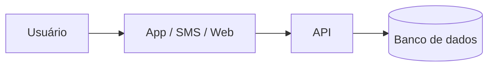

# PIST — Plataforma Integrada de Solicitações e Transparência: automação auditável de pedidos administrativos municipais com acompanhamento cidadão


## Integrantes

## Integrantes

| Nome completo | GitHub | Área de carreira | RGM |
|---|---|---|---|
| Bruno Rodrigues | dev-rodrigues-bruno | Gestão | 48101541 |
| Caio Dal Pizzol Fonseca | caio-fonseca | Cibersegurança e Gestão | 47923121 |
| Denner de Paula Coutinho | denner-coutinho | Engenharia de Dados e Gestão | 48094030 |
| João Vitor Pires Ribeiro | Joaovp07 | Ciência de Dados e Gestão | 47792591 |
| Nicollas Guedes Da Silva Santos | Nicollas-Guedes | Engenharia de Dados e Cloud | 48131334 |

**Dossiê:** 5 - Moderação automatizada e transparência 

**Recorte:** digitalização e automação, por regras auditáveis e com decisão final sempre humana, das solicitações administrativas de uma prefeitura, permitindo ao cidadão abrir e acompanhar o pedido online e à população consultar indicadores agregados de desempenho em um painel público. A implantação começa por um piloto em um único serviço municipal.


## 1. Análise do problema


### 1.1 Quem é afetado, onde e quanto
[Dados, com a fonte citada]


### 1.2 Causas
[Destaque para as causas tecnológicas: sistemas, dados, redes, decisões de projeto]


### 1.3 O que já existe e por que não basta


## 2. Proposta tecnológica


### 2.1 A solução, do ponto de vista do usuário
[O que é, para quem, e como funciona passo a passo]


### 2.2 Arquitetura





[Que dados entram, onde ficam e quem acessa]


### 2.3 O trabalho de cada área


#### [Área 1]
#### [Área 2]
#### Como as áreas se complementam


### 2.4 O que a tecnologia não resolve


## 3. Análise ética

A plataforma PIST deve garantir segurança, privacidade e transparência no tratamento das informações dos cidadãos. A automação será utilizada para auxiliar os servidores, sem substituir a decisão humana.

### 3.1 Matriz de riscos

| # | Risco | Classificação | Impacto | Controle |
|---|---|---|---|---|
| 1 | Vazamento de dados pessoais | Segurança / Legal-privacidade | Exposição de informações dos cidadãos. | Criptografia e controle de acesso. |
| 2 | Classificação incorreta dos pedidos | Ético / Viés-inclusão | Atrasos no atendimento. | Revisão por servidores. |
| 3 | Falta de transparência | Ético / Governança | Cidadão sem informações sobre seu pedido. | Histórico e status disponíveis. |
| 4 | Acesso indevido ao sistema | Segurança | Consulta ou alteração de dados sem autorização. | Autenticação e registro de acessos. |
| 5 | Exclusão digital | Viés-inclusão / Ético | Dificuldade de acesso para parte da população. | Manter atendimento presencial e interface acessível. |
| 6 | Decisões somente automatizadas | Ético / Governança | Cidadãos prejudicados por erros do sistema. | Aprovação humana nas decisões administrativas. |

### 3.2 Decisão

**Implantar com controles**

A plataforma pode melhorar os serviços municipais, facilitar solicitações e aumentar a transparência. Porém, sua implantação depende de medidas de segurança, proteção de dados e revisão humana. O projeto deverá começar com um serviço piloto, permitindo identificar e corrigir problemas antes de sua expansão.

### 3.3 Controles antes de entrar em produção

| Eixo | Controle | Quem faz | Como saber que foi cumprido |
|---|---|---|---|
| Transparência | Informar como o sistema utiliza os dados. | Gestão | Aviso de privacidade publicado. |
| Revisão humana | Garantir decisões finais por servidores. | Prefeitura | Fluxo de aprovação testado. |
| Minimização de dados | Coletar somente dados necessários. | Desenvolvimento | Formulários revisados. |
| Segurança | Proteger acessos e informações. | Cibersegurança | Testes de segurança realizados. |
| Teste de viés | Verificar erros e possíveis discriminações. | Dados e gestão | Resultados documentados. |
| Canal de contestação | Permitir questionamentos dos cidadãos. | Prefeitura | Canal disponível e funcionando. |

### 3.4 LGPD

A plataforma deverá seguir a Lei Geral de Proteção de Dados (Lei nº 13.709/2018), coletando apenas informações necessárias e garantindo seu armazenamento seguro.

| Dado pessoal | Finalidade | Base legal | Por quanto tempo | Sensível ou de criança/adolescente? |
|---|---|---|---|---|
| Nome completo | Identificar o cidadão. | Art. 7º, III, quando aplicável. | Conforme regras de conservação documental. | Não. |
| CPF | Confirmar identidade, quando necessário. | Art. 7º, III, quando aplicável. | Conforme necessidade e obrigações legais. | Não. |
| E-mail e telefone | Enviar atualizações. | Art. 7º, III, quando aplicável. | Enquanto necessários para o atendimento. | Não. |
| Endereço | Verificar localização, quando necessário. | Art. 7º, III, quando aplicável. | Conforme necessidade do serviço. | Não. |
| Solicitação e anexos | Analisar o pedido. | Arts. 7º, 11 e 23, conforme o dado e a finalidade. | Conforme regras de conservação documental. | Podem conter. |

**Observação:** dados sensíveis ou de menores deverão receber proteção adicional. O painel público apresentará apenas indicadores agregados, sem identificar os cidadãos.

### 3.5 Comunicado público

> A PIST facilita o acesso aos serviços municipais, permitindo que os cidadãos registrem solicitações e acompanhem seu andamento pela internet. A tecnologia auxilia na organização dos pedidos, mas as decisões finais continuam sob responsabilidade dos servidores. As informações pessoais serão protegidas conforme a LGPD, e a população poderá consultar indicadores públicos de transparência.

**Contagem:** aproximadamente 430 caracteres.


**Contagem:** [N] caracteres


## 4. Acessibilidade e inclusão digital


### 4.1 Quem pode ficar de fora


| Grupo | Barreira | O que a solução faz |
|---|---|---|
| | | |


### 4.2 Requisitos de acessibilidade
[Requisitos concretos, com o critério WCAG correspondente]


## 5. Sustentabilidade


### 5.1 Impacto ambiental da solução
### 5.2 Sustentabilidade do projeto
[Quem mantém, quem paga, o que acontece depois do primeiro ano]


## 6. Impacto esperado


### 6.1 Indicadores


| Indicador | Como medir | Meta | Prazo |
|---|---|---|---|
| | | | |


### 6.2 Como os usuários serão ouvidos
### 6.3 Se a solução não pegar


## 7. Quadro de decisões (mínimo 5)


| Decisão | Alternativas consideradas | Por que escolhemos esta |
|---|---|---|
| | | |


## 8. Capítulos individuais


### 8.1 [Nome do integrante] — [Área]


**Papel no projeto:** [pelo que respondeu e o que produziu]


**Plano de desenvolvimento**


| Competência que a solução exige | Técnica ou comportamental | Já tenho? |
|---|---|---|
| | | |


**Metas SMART (6 a 12 meses)**
1. [Específica, mensurável, atingível, relevante e com prazo]


**Feedback dos colegas**
[Avaliação construtiva e propositiva, escrita em conjunto pelos demais integrantes]


### 8.2 [Próximo integrante] — [Área]
### 8.3 [Próximo integrante] — [Área]
### 8.4 [Próximo integrante (se houver)] — [Área]
### 8.5 [Próximo integrante (se houver)] — [Área]


## 9. Referências


- [Autor ou órgão]. *[Título]*. [Veículo], [data]. [link]
````
